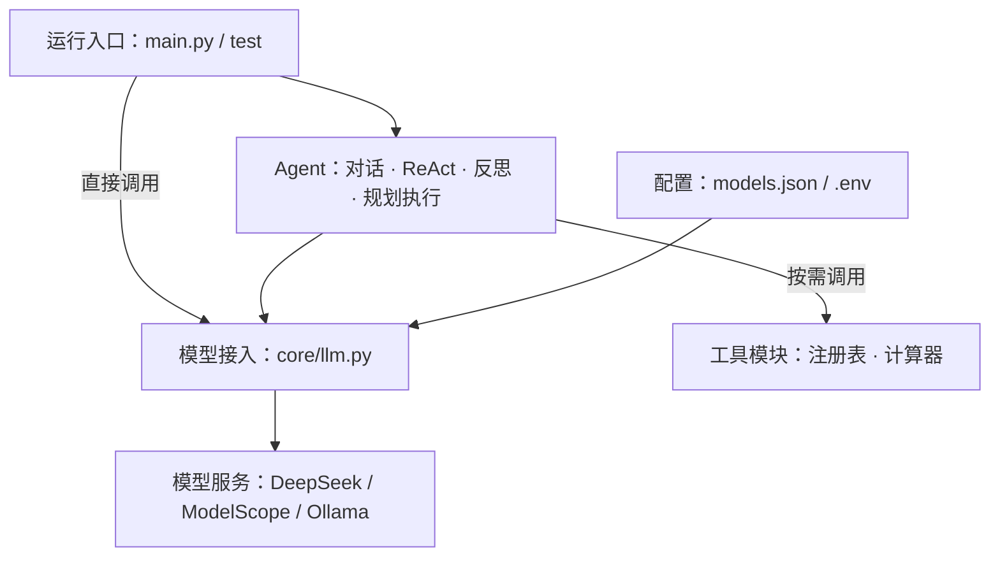

# agent-practice

参考 Hello Agents 教程的 Agent 实践项目，自行实现模型接入、对话、工具调用、反思和规划执行，并提供 Agent 架构与流程演示，展示代码与调用关系。

项目正在持续完善，业务组件均在本地实现，不依赖教程配套框架。当前进度按源码实现情况记录，不代表所有分支均已通过自动化测试。

## 开发进度

更新时间：2026-10-16。

| 模块 | 当前进度 | 已有能力与后续完善点 |
|---|---|---|
| 模型接入 | 已实现 | `create_llm()` 按配置选择服务商和模型，密钥从环境变量读取 |
| 基础组件 | 已实现基础定义 | 本地 `Agent`、`Message`、`Config`，为Agent提供统一接口与消息结构 |
| SimpleAgent | 已实现主要流程 | 普通对话、历史消息、流式响应、提示词工具循环；继续完善工具管理边界 |
| ReActAgent | 已实现主要流程 | 继承本地Agent，实现行动解析、工具调度和结束判断，已有离线测试 |
| ReflectionAgent | 已实现主要流程 | 初次回答、反思、改进、短期轨迹、自定义模板与停止判断 |
| PlanAndSolveAgent | 已实现主要流程 | 先生成计划，再逐步执行，流式片段收集为完整文本 |
| 本地工具注册表 | 已实现主要接口 | 支持对象与函数执行、查询、列举及移除；schema 方法待完善 |
| 计算器工具 | 已实现基础能力 | AST 解析、加减乘除、`sqrt` 与 `pi`；正负号等表达式分支待完善 |
| Agent 架构与流程演示 | 已实现 | 节点拖动、画布平移缩放、源码弹窗、调用跳转、信息流模拟与流程图视图 |
| 搜索与编排 | 部分实现 | 高级搜索、顺序工具链与线程池并发执行；部分搜索接口和接入流程待完善 |
| 测试 | 已有离线测试与运行示例 | 客户端、ReAct、注册表与计算器已有离线断言；功能示例可调用真实服务 |
| 预留模块 | 占位 | `tools/builtin/` 下的工具文件与 `core/exceptions.py` 尚未实现 |

## 架构图

按主要模块展示项目结构，省略具体函数与类的继承关系。



`main.py` 直接调用模型，Agent 示例位于 `test/`。Agent 架构与流程演示用于查看源码与演示流程，不参与实际推理。

## 功能模块

| 目录或文件 | 说明 |
|---|---|
| `core/llm.py` | 本地LLM客户端与配置工厂，提供普通调用和流式响应 |
| `models.json` | 服务商地址、默认模型和可选模型记录，当前默认服务商为 DeepSeek |
| `core/agent.py` | 本地 Agent 抽象接口与消息历史管理 |
| `core/message.py`、`core/config.py` | 消息结构、角色类型与运行配置 |
| `agents/` | 对话、ReAct、反思、规划执行四种 Agent 实践 |
| `tools/base.py` | Tool 抽象类与 ToolParameter 参数定义 |
| `tools/registry.py` | 本地工具注册、描述与函数执行入口 |
| `tools/calculator_tool.py` | 字符串数学表达式计算及计算器注册函数 |
| `test/` | 各功能的运行示例与测试入口，部分会请求真实模型 |
| `web/` | 无需 npm 的本地前端，提供 Agent 架构与流程演示、真实源码阅读 |
| `docs/` | 开发说明、源码分析和 Mermaid 流程图 |

## 本地运行

使用 Python 3.11，在项目根目录安装业务依赖。模型调用通过 OpenAI SDK 连接兼容接口，仓库暂未提供完整依赖锁定文件。

```powershell
python -m pip install openai python-dotenv pydantic
Copy-Item .env.example .env
```

在 `.env` 中填写需要使用的服务商密钥，然后确认 `models.json` 中的 `defaultProvider` 和对应的 `defaultModel`。真实 `.env` 已加入 Git 忽略规则，模板只保留变量名称。

```powershell
# 直接调用模型
python -X utf8 main.py

# 分别运行功能示例
python -X utf8 -m test.test_simple_agent
python -X utf8 -m test.test_reflection_agent
python -X utf8 -m test.test_plan_solve_agent
python -X utf8 -m test.test_calculator
```

这些入口会访问所配置的模型服务。当前测试文件以功能演示为主，正常输出与退出不等同于所有分支已验证。

离线测试无需真实密钥或模型服务：

```powershell
python -m pip install pytest
python -X utf8 -m pytest test/test_llm.py test/test_react_agent.py test/test_tool_registry.py test/test_calculator_tool.py -q
```

搜索功能另外使用 `tavily-python` 或 `serpapi` 等 SDK，需按所选后端配置对应密钥。

代码中也可以显式选择服务商与模型：

```python
from core.llm import create_llm

llm = create_llm()  # models.json 中的默认配置
llm = create_llm(provider="ollama", model="qwen3.5:4b")
```

使用 Ollama 前，需要本地服务已启动且指定模型已安装。

## Agent 架构与流程演示

```powershell
python web/serve.py
```

打开 <http://127.0.0.1:5173>。点击节点查看源码与讲解，左键拖动节点，按住右键或中键拖动画布。启动时刷新源码与图表索引；前端信息流用于教学演示，不会执行真实模型请求。

前端操作与维护说明位于 `web` 目录。

## 随开发维护

- 新增、移除模块或改变调用关系时，同步更新本 README 的开发进度、功能模块与架构图。
- 架构图直接使用本文中的 Mermaid 源码维护，GitHub 可渲染；它不会自动根据 Python 代码生成。
- 区分“已编写”“已验证”和“待完善”，只展示当前代码已有的能力。
- 更新 Agent 架构与流程演示时，同时核对源码索引、节点说明与连线；执行 `python web/generate_sources.py` 刷新索引。README 架构图与前端视图需分别维护。

## 开发文档

`docs` 目录用于记录项目的设计思路、源码分析与开发说明，主要包括：

- 模型服务配置、密钥管理与模型切换。
- LLM 客户端和各类 Agent 的职责、执行流程与实现边界。
- 工具注册、计算器求值和组件调用关系。
- 架构与流程演示的使用方法、图表说明及维护约定。

具体文档随开发持续整理，阅读时可从 `docs` 目录中的文档导航开始。

项目学习参考：[Hello Agents](https://github.com/datawhalechina/hello-agents)。部分历史文档记录的是对应开发时点，判断当前行为时以源码为准。
