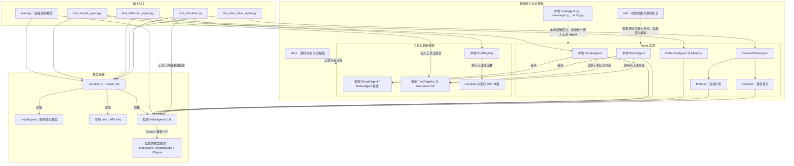

# agent-practice

基于 Hello Agents 教程与 `hello-agents` 框架的 Agent 学习实践项目，逐步实现模型接入、对话、工具调用、反思和规划执行，并通过交互式研发地图展示代码与调用关系。

项目正在持续完善。部分组件复用已安装框架，部分为本地实现；当前进度按源码实现情况记录，不代表所有分支均已通过自动化测试。

## 开发进度

更新时间：2026-10-16。

| 模块 | 当前进度 | 已有能力与后续完善点 |
|---|---|---|
| 模型接入 | 已实现 | `create_llm()` 按配置选择服务商和模型，密钥从环境变量读取 |
| 基础组件 | 已实现基础定义 | 本地 `Agent`、`Message`、`Config`；与框架同名类的使用尚未统一 |
| SimpleAgent | 已实现主要流程 | 普通对话、历史消息、流式响应、提示词工具循环；继续完善工具管理边界 |
| ReActAgent | 已编写，待完善验证 | Thought / Action / Observation 循环与结束判断；需核对父类初始化参数映射 |
| ReflectionAgent | 已实现主要流程 | 初次回答、反思、改进、短期轨迹、自定义模板与停止判断 |
| PlanAndSolveAgent | 已实现主要流程 | 先生成计划，再逐步执行，流式片段收集为完整文本 |
| 本地工具注册表 | 部分实现 | 可注册 Tool 对象与函数；当前 `execute_tool()` 只执行函数工具，schema 方法待完善 |
| 计算器工具 | 已实现基础能力 | AST 解析、加减乘除、`sqrt` 与 `pi`；正负号等表达式分支待完善 |
| 交互式研发地图 | 已实现 | 节点拖动、地图平移缩放、源码弹窗、调用跳转、信息流模拟与流程图视图 |
| 测试示例 | 已有运行入口 | 对话、反思、规划执行、计算器示例；自动化断言覆盖待补充 |
| 其他工具 | 占位 | `tools/chain.py`、`tools/async_executor.py` 和 `tools/builtin/` 下的工具文件尚未实现 |

## 架构图

图中实线表示调用、配置读取或继承，虚线表示说明与关联。各示例会分别创建模型客户端，并非共享全局实例。



当前 `main.py` 直接调用模型，尚未接入 Agent。计算器测试由测试函数手动调用工具后，再请求模型组织回答，没有实例化 `SimpleAgent`。本地与框架的注册表是两个不同实现，不能假定接口完全一致。

## 功能模块

| 目录或文件 | 说明 |
|---|---|
| `core/llm.py` | 模型客户端工厂，显式传入 provider、model、base_url、api_key |
| `models.json` | 服务商地址、默认模型和可选模型记录，当前默认服务商为 DeepSeek |
| `core/agent.py` | 本地 Agent 抽象接口与消息历史管理 |
| `core/message.py`、`core/config.py` | 消息结构、角色类型与运行配置 |
| `agents/` | 对话、ReAct、反思、规划执行四种 Agent 实践 |
| `tools/base.py` | Tool 抽象类与 ToolParameter 参数定义 |
| `tools/registry.py` | 本地工具注册、描述与函数执行入口 |
| `tools/calculator_tool.py` | 字符串数学表达式计算及计算器注册函数 |
| `test/` | 各功能的运行示例与测试入口，部分会请求真实模型 |
| `web/` | 无需 npm 的本地前端，展示研发地图、真实源码与调用流程 |
| `docs/` | 开发说明、源码分析和 Mermaid 流程图 |

## 本地运行

使用 Python 3.11，在项目根目录执行以下命令。现有开发环境使用 `hello-agents` 0.1.1；仓库暂未提供完整依赖锁定文件。

```powershell
python -m pip install hello-agents==0.1.1 python-dotenv pydantic
Copy-Item .env.example .env
```

在 `.env` 中填写需要使用的服务商密钥，然后确认 `models.json` 中的 `defaultProvider` 和对应的 `defaultModel`。真实 `.env` 已加入 Git 忽略规则，模板只保留变量名称。

```powershell
# 直接调用模型
python -X utf8 main.py

# 分别运行功能示例
python -X utf8 -m test.test_simple_agent
python -X utf8 -m test.test_reflection_agent
python -X utf8 -m test.test_plan_solve_agent
python -X utf8 -m test.test_calculator
```

这些入口会访问所配置的模型服务。当前测试文件以功能演示为主，正常输出与退出不等同于所有分支已验证。

代码中也可以显式选择服务商与模型：

```python
from core.llm import create_llm

llm = create_llm()  # models.json 中的默认配置
llm = create_llm(provider="ollama", model="qwen3.5:4b")
```

使用 Ollama 前，需要本地服务已启动且指定模型已安装。

## 交互式研发地图

```powershell
python web/serve.py
```

打开 <http://127.0.0.1:5173>。点击节点查看源码与讲解，左键拖动节点，按住右键或中键拖动地图。启动时刷新源码与图表索引；前端信息流用于教学演示，不会执行真实模型请求。

详见 [web 使用说明](web/README.md)。

## 随开发维护

- 新增、移除模块或改变调用关系时，同步更新本 README 的开发进度、功能模块与架构图。
- 架构图直接使用本文中的 Mermaid 源码维护，GitHub 可渲染；它不会自动根据 Python 代码生成。
- 区分“已编写”“已验证”和“待完善”，只展示当前代码已有的能力。
- 更新研发地图时，同时核对源码索引、节点说明与连线；执行 `python web/generate_sources.py` 刷新索引。README 架构图与前端地图需分别维护。

## 开发文档

- [模型服务配置与切换说明](docs/模型服务配置与切换说明.md)
- [HelloAgentsLLM 源码与执行流程分析](docs/HelloAgentsLLM源码与执行流程分析.md)
- [计算器工具调用流程](docs/计算器工具调用流程.md)
- [核心代码流程](docs/flows/核心代码流程.md)
- [Agent 研发地图说明](docs/Agent研发地图说明.md)
- [流程图视图说明](docs/流程图视图说明.md)

项目学习参考：[Hello Agents](https://github.com/datawhalechina/hello-agents)。部分历史文档记录的是对应开发时点，判断当前行为时以源码为准。
