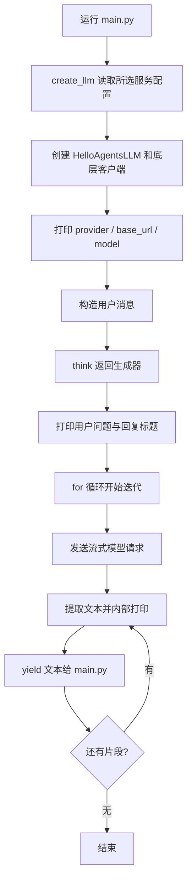

# HelloAgentsLLM 源码与执行流程分析

核对日期：2026-10-16。本文以项目 `main.py`、`core/llm.py` 和当前 Conda 环境安装的 `hello-agents` 0.1.1 源码为依据，不把框架内置默认值当作服务端可用性保证。

配置填写与模型切换见 [模型服务配置与切换说明](模型服务配置与切换说明.md)；Agent 如何使用客户端见 [Agent 设计与执行流程](Agent设计与执行流程.md)。

## 1. 当前调用关系

```text
main.py
  → core.llm.create_llm()
  → 框架 HelloAgentsLLM
  → OpenAI Python 客户端
  → 配置指定的模型服务
```

当前入口为：

```python
from core.llm import create_llm

llm = create_llm()
```

`core/llm.py` 现在是配置工厂，不再定义自有 `LLM` 子类。工厂返回框架 `HelloAgentsLLM` 对象，不负责模型推理，也不另建一套聊天接口。

当前配置的默认服务为 DeepSeek。请求目标由实例的 `base_url` 决定，模型 ID 由 `model` 决定；使用 OpenAI SDK 并不代表请求发送给 OpenAI 官方。

## 2. main.py 的完整流程



`main.py` 目前没有 `def main()` 或入口保护，代码位于模块顶层。导入该模块也会执行顶层语句，包括消费生成器并发送请求。

`for chunk in response_stream: pass` 虽然循环体不打印，仍会驱动生成器；文本由 `think()` 内部打印。

## 3. create_llm()：选择配置并创建对象

工厂依次执行：

1. `load_dotenv(PROJECT_ROOT / ".env")` 加载项目密钥，不覆盖已有进程环境变量。
2. 读取默认 `models.json`，或 `config_path` 指定的文件。
3. 使用 `provider` 参数，否则使用 `defaultProvider`。
4. 从对应服务读取 `defaultModel`、`baseUrl` 和密钥来源；显式 `model` 优先。
5. 检查密钥非空，显式传入四项连接参数，返回客户端。

核心调用：

```python
return HelloAgentsLLM(
    provider=provider,
    model=model,
    base_url=base_url,
    api_key=api_key,
)
```

`provider: str | None` 是参数类型提示。`llm: HelloAgentsLLM` 同样只是说明变量预期类型，不会创建第二个客户端，也不会切换服务。

## 4. 框架方法总览

| 方法 | 职责 | 当前 main 路径 |
|---|---|---|
| `__init__()` | 初始化参数并创建底层客户端 | 使用 |
| `_auto_detect_provider()` | 未传入有效 provider 时推测服务商 | 正常工厂配置下跳过 |
| `_resolve_credentials()` | 根据 provider 解析地址与密钥 | 使用，显式值优先 |
| `_get_default_model()` | 模型未提供时补框架默认名称 | 正常工厂配置下跳过 |
| `_create_client()` | 创建 `OpenAI` SDK 客户端 | 使用 |
| `think()` | 流式请求、内部打印、逐段返回文本 | 使用 |
| `invoke()` | 默认非流式调用，返回回答文本 | Agent 的部分路径使用 |
| `stream_invoke()` | 委托给 `think()` 的流式入口 | SimpleAgent 流式路径使用 |

方法名前的下划线是内部使用约定，不是访问权限控制。

## 5. __init__()：初始化不等于发送请求

关键逻辑摘录：

```python
self.model = model or os.getenv("LLM_MODEL_ID")
self.temperature = temperature
self.max_tokens = max_tokens
self.timeout = timeout or int(os.getenv("LLM_TIMEOUT", "60"))
self.kwargs = kwargs

self.provider = provider or self._auto_detect_provider(api_key, base_url)
self.api_key, self.base_url = self._resolve_credentials(api_key, base_url)

if not self.model:
    self.model = self._get_default_model()

self._client = self._create_client()
```

框架还会检查密钥和地址是否为真值。默认温度为 `0.7`，`max_tokens=None`；超时读取 `LLM_TIMEOUT`，否则为 60 秒。

这里的 `or` 取第一个真值，空字符串和 `timeout=0` 会触发后续来源。当前工厂为正常配置显式提供非空连接参数，因此不依赖服务商推测和框架默认模型。

创建 SDK 客户端不等于验证密钥、地址或模型有效，也不会下载模型。`self.kwargs` 被保存，但没有自动展开到后续模型请求。

## 6. 自动检测与凭证解析

只有未提供有效 `provider` 时，框架才执行自动检测。顺序如下，命中后立即返回：

1. 服务商专属环境变量。
2. 传入密钥或 `LLM_API_KEY` 的格式。
3. 传入地址或 `LLM_BASE_URL` 的内容。
4. 无法识别则返回 `"auto"`。

专属变量的优先顺序：

```text
OPENAI_API_KEY → DEEPSEEK_API_KEY → DASHSCOPE_API_KEY
→ MODELSCOPE_API_KEY → KIMI_API_KEY / MOONSHOT_API_KEY
→ ZHIPU_API_KEY / GLM_API_KEY
→ OLLAMA_API_KEY / OLLAMA_HOST → VLLM_API_KEY / VLLM_HOST
```

它不会检测机器上安装了什么模型，也不会访问服务端确认配置。因此不能理解成“本地模型优先”。

```python
HelloAgentsLLM()                 # provider=None，尝试自动检测
HelloAgentsLLM(provider="auto")  # 非空字符串，直接使用通用配置分支
```

`_resolve_credentials()` 大部分云端分支按以下顺序取值：

```text
密钥：显式 api_key → 服务商专属变量 → LLM_API_KEY
地址：显式 base_url → LLM_BASE_URL → 服务商默认地址
```

Ollama 的地址还会优先考虑 `OLLAMA_HOST`，密钥缺省可用占位值 `"ollama"`。vLLM 有类似的 `VLLM_HOST` 与占位密钥。

直接使用框架时，可能检测到一个服务商，却从通用环境变量取到另一个服务的地址。过去出现的“provider 显示 modelscope，但访问 localhost”属于这种混配。当前工厂按同组配置显式传参，避免正常配置下的这一问题。

## 7. _create_client() 与默认模型

底层客户端通过以下方式创建：

```python
OpenAI(
    api_key=self.api_key,
    base_url=self.base_url,
    timeout=self.timeout,
)
```

只有显式模型和 `LLM_MODEL_ID` 都无有效值时，框架才补默认名称。例如当前安装版本内置 `deepseek-chat`、`llama3.2` 等字符串；这些并非本项目的默认选择，也不保证服务端仍接受。

模型部署、加载权重与执行推理由模型服务负责。客户端负责发送请求和处理响应。

## 8. think()：文本生成器

```python
response = self._client.chat.completions.create(
    model=self.model,
    messages=messages,
    temperature=temperature if temperature is not None else self.temperature,
    max_tokens=self.max_tokens,
    stream=True,
)

for chunk in response:
    content = chunk.choices[0].delta.content or ""
    if content:
        print(content, end="", flush=True)
        yield content
```

底层 SDK 返回的 `chunk` 是响应对象；`think()` 对外返回的是提取后的文本片段，不保证一个片段对应一个字、词或句子。空文本片段被跳过。

`yield` 把当前片段交给调用方，并暂停函数；下一次迭代继续读取响应。`flush=True` 立即刷新终端输出缓冲区。

当前实现只提取第一项 choice 的文本，假定 `choices[0]` 存在，不向调用方返回完整的工具调用、用量或其他响应字段。

## 9. 创建生成器与收集文本

```python
response_stream = llm.think(messages)  # 只创建生成器
for chunk in response_stream:         # 迭代时才进入函数体并请求服务
    pass
```

需要完整结果供后续解析时：

```python
response_text = ""
for chunk in llm.think(messages):
    response_text += chunk
```

也可以使用：

```python
response_text = "".join(llm.think(messages))
```

两种方式都会消费生成器，且保留内部实时打印。不能直接对生成器使用 `.split()`，也不能把生成器对象当作最终答案。消费完的同一生成器再次迭代不会重新发送请求。

调用方再次 `print(chunk)` 会重复打印，因为 `think()` 已打印这段文本。

## 10. invoke() 与 stream_invoke()

| 方法 | 默认请求方式 | 返回值 | 内部打印回答 |
|---|---|---|---|
| `think()` | 流式 | 文本生成器 | 是 |
| `invoke()` | 非流式 | `message.content` | 否 |
| `stream_invoke()` | 委托 `think()` | 文本生成器 | 是 |

`invoke()` 支持调用时覆盖 `temperature`、`max_tokens`，其余关键字参数转交 SDK。它按普通响应结构读取 `response.choices[0].message.content`，所以不能简单传 `stream=True` 把它变为流式接口。

原生函数调用响应中的 `tool_calls` 不会被这个返回文本的封装保留，且 `message.content` 可能为 `None`。这也是提示词工具协议与原生 Function Calling 不能直接等同的原因。

`stream_invoke()` 核心为：

```python
temperature = kwargs.get("temperature")
yield from self.think(messages, temperature)
```

它虽然接收 `**kwargs`，当前只转发温度。

## 11. 消息与历史

```python
messages = [{"role": "user", "content": "你好，请介绍一下你自己。"}]
```

`role` 是消息角色，`content` 是正文。`HelloAgentsLLM` 不自动维护聊天历史；需要由 Agent 或调用方把历史消息加入下一轮请求。

创建客户端是确定“请求哪个模型、如何连接”；创建 Agent 是把该客户端交给具体的任务流程。将已有客户端传入 Agent 不会自动切换回本地模型，实际行为取决于该 Agent 是否继续使用传入的对象。

## 12. 异常与排查

`think()`、`invoke()` 会把请求或响应处理异常包装为 `HelloAgentsException`。流式异常通常在调用方的 `for` 循环中出现，而非创建生成器时。

| 表现 | 优先检查 |
|---|---|
| 401 认证失败 | 当前地址对应的密钥是否正确；已有进程环境变量是否覆盖了文件值 |
| 400 / Invalid model id | 最终模型 ID 是否为该地址支持的模型 |
| 无法连接或超时 | 地址、端口、服务状态与网络 |
| 输出生成器对象 / 没有 split 属性 | 是否遗漏迭代或拼接文本 |
| 终端输出重复 | 调用方是否重复打印 `think()` 的片段 |
| GBK 编码错误 | 用 `python -X utf8 main.py` 运行 |

`think()` 开头的表情打印位于请求的 `try` 外，编码错误可能在发送请求前发生。“响应成功”提示也早于完整流结束，不能据此断定所有片段均已正常接收。

排查时打印 `provider`、`base_url` 和 `model` 即可，不要打印密钥。

返回 [文档导航](文档导航.md)。
