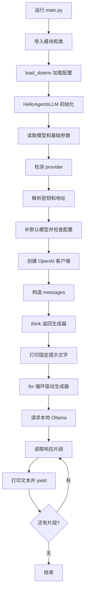

# HelloAgentsLLM 源码与 main.py 执行流程分析

> 历史说明：本文记录配置工厂改造前的入口和配置状态。当前 main.py 已使用 create_llm() 显式选择整组服务配置，原自定义 LLM 子类已替换。当前使用方法参见 [模型服务配置与切换说明](../docs/模型服务配置与切换说明.md)。基础类函数和流式机制的分析仍可参考。

记录日期：2026-10-15。本文根据本项目当前代码和 `hello-agents` Conda 环境中安装的源码整理。默认值和实现细节均对应当前安装版本。

## 1. 分析范围与结论

涉及文件：

- `main.py`：加载环境变量、创建客户端、发送消息并消费响应。
- `core/llm.py`：项目自定义的 `LLM` 子类，同时导入安装包的 `HelloAgentsLLM`。
- `.env`：运行配置，不在本文记录真实密钥。
- `D:/Dev/Cache/conda/envs/hello-agents/Lib/site-packages/hello_agents/core/llm.py`：基础类的实际源码。

当前生效的实例化语句为：

```python
llm = HelloAgentsLLM()
```

完整链路为：加载配置 → 初始化客户端 → 构造消息 → 创建生成器 → 遍历生成器 → 调用本地 Ollama → 逐段输出回答。

此前实际初始化检查和成功运行时，解析结果如下：

| 属性 | 值或来源 |
|---|---|
| provider | `modelscope` |
| model | `qwen3.5:4b` |
| base_url | `http://localhost:11434/v1` |
| api_key | 来自 `MODELSCOPE_API_KEY`，不记录实际值 |
| temperature | `0.7` |
| timeout | `60` 秒 |

这是服务商标记、密钥和本地地址混用的情况。`provider` 决定配置解析分支，实际请求目标由 `base_url` 决定。上述运行实际访问本地 Ollama，并未访问 ModelScope 云端。后续修改环境变量可能改变结果。

## 2. 类与导入关系

`main.py`：

```python
from core.llm import LLM
from core.llm import HelloAgentsLLM
```

`core/llm.py`：

```python
from hello_agents import HelloAgentsLLM

class LLM(HelloAgentsLLM):
    ...
```

关系为：

```text
安装包中的 HelloAgentsLLM
└── 项目自定义子类 LLM
```

通过 `core.llm` 导入的 `HelloAgentsLLM`，仍然是安装包中的原类。当前没有实例化 `LLM`，因此不会进入自定义子类的初始化分支。

自定义子类仅在 `provider == "modelscope"` 时自行设置凭证、模型和客户端，其他情况调用 `super().__init__(...)`。当前主程序直接创建基础类，与该分支无关。

另一个差异是：子类的 `provider` 默认值为字符串 `"auto"`，基础类默认值为 `None`。由于基础类使用 `provider or 自动检测`，这两个默认值会产生不同的自动检测行为。

## 3. 总体流程图



当前 `main.py` 没有定义 `def main()`，代码位于模块顶层，自上而下执行。导入该模块也会执行这些顶层语句。

## 4. 环境变量加载

```python
load_dotenv()
```

这属于 `python-dotenv` 的功能，而非 `HelloAgentsLLM` 的内部实现：

```text
.env 文件 → load_dotenv() → 进程环境变量 → os.getenv() → 实例属性
```

规则：

- `#` 注释行不会加载。
- 同一个文件内同名变量重复定义时，后面的定义生效。
- `load_dotenv()` 默认不覆盖进程中已有的同名环境变量。
- `load_dotenv(override=True)` 才会允许文件配置覆盖已有进程环境变量。
- 基础类不会主动调用 `load_dotenv()`，调用方需要提前加载。

因此，编辑器启动环境、终端环境和 `.env` 不一致时，可能产生“文件已经修改，运行结果却没变”的情况。

## 5. 函数总览

| 函数 | 职责 | 当前主程序是否使用 |
|---|---|---|
| `__init__()` | 初始化参数、解析配置并创建客户端 | 是 |
| `_auto_detect_provider()` | 未指定 provider 时自动识别 | 是 |
| `_resolve_credentials()` | 解析密钥和接口地址 | 是 |
| `_get_default_model()` | 未提供模型时返回默认名称 | 当前模型已提供，不使用 |
| `_create_client()` | 创建 OpenAI 格式的客户端 | 是 |
| `think()` | 发起流式调用、打印并逐段返回文本 | 是 |
| `invoke()` | 默认以非流式方式返回完整文本 | 否 |
| `stream_invoke()` | 委托给 think，提供兼容入口 | 否 |

以下划线开头的方法表示内部使用约定，不代表 Python 强制禁止外部访问。

## 6. 初始化：__init__()

主要参数：

```python
def __init__(
    self,
    model=None,
    api_key=None,
    base_url=None,
    provider=None,
    temperature=0.7,
    max_tokens=None,
    timeout=None,
    **kwargs,
):
    ...
```

| 参数 | 作用 |
|---|---|
| model | API 请求中的模型 ID |
| api_key | 客户端认证信息 |
| base_url | API 服务地址 |
| provider | 配置解析分支 |
| temperature | 采样温度，默认 0.7 |
| max_tokens | 输出 token 数量限制，默认 None |
| timeout | 客户端超时配置 |
| kwargs | 保存到 self.kwargs 的额外参数 |

执行顺序：

```python
self.model = model or os.getenv("LLM_MODEL_ID")
self.temperature = temperature
self.max_tokens = max_tokens
self.timeout = timeout or int(os.getenv("LLM_TIMEOUT", "60"))
self.kwargs = kwargs

self.provider = provider or self._auto_detect_provider(api_key, base_url)
self.api_key, self.base_url = self._resolve_credentials(api_key, base_url)

if not self.model:
    self.model = self._get_default_model()

if not all([self.api_key, self.base_url]):
    raise HelloAgentsException(...)

self._client = self._create_client()
```

`or` 取第一个真值，因此空字符串也会触发兜底配置。`timeout=0` 同样会触发环境变量或默认值。

初始化只检查密钥和地址是否为真值，不验证密钥有效性、服务连通性或模型是否存在。创建客户端时尚未发送聊天请求。

`self.kwargs` 只是被保存；当前类的请求方法没有自动将其展开到 API 调用中。

## 7. 自动检测：_auto_detect_provider()

检测分四层，命中后立即返回：

1. 服务商专属环境变量。
2. 传入密钥或 `LLM_API_KEY` 的格式。
3. 传入地址或 `LLM_BASE_URL` 的内容。
4. 无法识别则返回 `"auto"`。

专属环境变量的检测顺序为：

```text
OPENAI_API_KEY
DEEPSEEK_API_KEY
DASHSCOPE_API_KEY
MODELSCOPE_API_KEY
KIMI_API_KEY / MOONSHOT_API_KEY
ZHIPU_API_KEY / GLM_API_KEY
OLLAMA_API_KEY / OLLAMA_HOST
VLLM_API_KEY / VLLM_HOST
```

因此，存在 `MODELSCOPE_API_KEY` 时：

```python
if os.getenv("MODELSCOPE_API_KEY"):
    return "modelscope"
```

不会继续根据 `localhost:11434` 检测 Ollama。这是当前 provider 与请求地址不一致的原因。

密钥格式检测包含 `ms-` 前缀和 `ollama`、`vllm`、`local` 等值的判断；这些只是启发式判断，不会向服务端验证。

地址检测包含服务域名以及本地端口。例如本地 `11434` 会识别为 Ollama。当前源码在地址检测分支中要求本地地址同时包含 `:8000` 和 `vllm` 才直接认作 vLLM；仅有 `localhost:8000` 不一定识别为 vLLM。

### 省略 provider 与指定 auto 的区别

```python
HelloAgentsLLM()                 # provider=None，触发自动检测
HelloAgentsLLM(provider="auto")  # 非空字符串，不触发自动检测
```

原因是初始化使用 `provider or self._auto_detect_provider(...)`。显式 `"auto"` 会进入后续通用配置分支。

源码中的 `SUPPORTED_PROVIDERS = Literal[...]` 是类型提示，未在运行时实施严格的枚举校验。

## 8. 配置解析：_resolve_credentials()

大部分云端分支遵循：

```text
密钥：传入值 → 服务商专属环境变量 → LLM_API_KEY
地址：传入值 → LLM_BASE_URL → 服务商默认地址
```

ModelScope 分支：

```python
resolved_api_key = (
    api_key
    or os.getenv("MODELSCOPE_API_KEY")
    or os.getenv("LLM_API_KEY")
)
resolved_base_url = (
    base_url
    or os.getenv("LLM_BASE_URL")
    or "https://api-inference.modelscope.cn/v1/"
)
```

当前专属密钥和本地通用地址都存在，因此会组合出 ModelScope 密钥与 Ollama 地址。代码没有检查二者是否配套。

Ollama 分支的优先级为：

```text
密钥：api_key → OLLAMA_API_KEY → LLM_API_KEY → "ollama"
地址：base_url → OLLAMA_HOST → LLM_BASE_URL → http://localhost:11434/v1
```

vLLM 分支类似，使用 `VLLM_API_KEY`、`VLLM_HOST`，默认地址为 `http://localhost:8000/v1`。

`auto` 及其他未匹配分支仅使用传入值或通用 `LLM_API_KEY`、`LLM_BASE_URL`。

## 9. 默认模型：_get_default_model()

只有传入模型与 `LLM_MODEL_ID` 都没有有效值时才调用。

部分源码默认值：

| provider | 默认模型字符串 |
|---|---|
| openai | gpt-3.5-turbo |
| deepseek | deepseek-chat |
| qwen | qwen-plus |
| modelscope | Qwen/Qwen2.5-72B-Instruct |
| ollama | llama3.2 |
| vllm | meta-llama/Llama-2-7b-chat-hf |
| local | local-model |

这些是当前源码内置字符串，不代表服务目前一定支持，也不会触发模型下载。

其他分支还会根据 `LLM_BASE_URL` 推断。注意这里读取的是环境变量，而不是已经解析好的 `self.base_url`。

## 10. 客户端创建：_create_client()

```python
return OpenAI(
    api_key=self.api_key,
    base_url=self.base_url,
    timeout=self.timeout,
)
```

使用 OpenAI Python 客户端不代表请求 OpenAI 官方服务，目标取决于传入的地址。

```text
HelloAgentsLLM → OpenAI Python 客户端 → 本地 Ollama → qwen3.5:4b
```

模型权重加载、硬件加速和推理由 Ollama 负责，HelloAgentsLLM 负责配置和 API 调用。

## 11. 消息结构与上下文

```python
messages = [
    {"role": "user", "content": "你好，请介绍一下你自己。"}
]
```

`role` 表示角色，常见值为 `system`、`user`、`assistant`；`content` 为消息文本。

该类不会自动维护历史消息。多轮对话需要调用方收集用户消息与模型回答，并在下一次请求中一起传入。

## 12. 流式调用：think()

接口：

```python
def think(self, messages, temperature=None) -> Iterator[str]:
    ...
```

请求核心：

```python
response = self._client.chat.completions.create(
    model=self.model,
    messages=messages,
    temperature=temperature if temperature is not None else self.temperature,
    max_tokens=self.max_tokens,
    stream=True,
)
```

调用时的 temperature 优先于初始化值，且使用 `is not None` 判断，因此传入 0 可以保留。

当前请求路径为：

```text
POST http://localhost:11434/v1/chat/completions
```

处理响应：

```python
for chunk in response:
    content = chunk.choices[0].delta.content or ""
    if content:
        print(content, end="", flush=True)
        yield content
print()
```

每个 chunk 是响应对象，提取出的 content 才是文本。片段不保证对应一个完整字、词或句子。空文本不会被返回。

`flush=True` 立即刷新输出缓冲区。`yield content` 将片段交给调用方并暂停，等下一次迭代时继续。

当前实现只读取第一项 choice 的文本，不返回完整响应对象、用量、工具调用或其他额外字段，并假定 chunk.choices[0] 存在。

## 13. 生成器与 main.py 的配合

```python
response_stream = llm.think(messages)
```

由于 think 包含 yield，以上语句只创建生成器，不执行函数体，也不发送请求。

```python
print("ModelScope Response:")
for chunk in response_stream:
    pass
```

for 循环才驱动执行：

```text
进入 think → 请求响应 → 提取文本 → 内部打印 → yield
    → main.py 执行 pass → 下一次迭代继续 think
```

因此外层 pass 仍有输出，因为文本在 think 内打印。外层若再打印 chunk，通常会重复输出。

需要保存完整文本时可使用：

```python
answer = "".join(llm.think(messages))
```

这也会消费生成器并触发内部打印。已消费完的同一个生成器不会自动重新发起请求。

## 14. 非流式调用：invoke()

```python
answer = llm.invoke(messages)
print(answer)
```

核心逻辑：

```python
response = self._client.chat.completions.create(
    model=self.model,
    messages=messages,
    temperature=kwargs.get("temperature", self.temperature),
    max_tokens=kwargs.get("max_tokens", self.max_tokens),
    **{k: v for k, v in kwargs.items()
       if k not in ["temperature", "max_tokens"]},
)
return response.choices[0].message.content
```

默认等待完整响应，不主动打印回答。调用参数可以覆盖 temperature、max_tokens，其他参数直接传给客户端。

虽然允许额外参数，但该方法按非流式响应结构提取结果，因此不能简单传入 `stream=True` 就把它当作流式方法。返回注解为 str，但实现未处理 message.content 为 None 的情况。

## 15. 兼容入口：stream_invoke()

```python
temperature = kwargs.get("temperature")
yield from self.think(messages, temperature)
```

它将 think 的文本片段继续转交给调用方，本身也是生成器。

虽然接收 kwargs，但只提取 temperature；其他调用参数不会传给 think。

| 方法 | 默认模式 | 返回内容 | 主动打印回答 |
|---|---|---|---|
| think | 流式 | 文本生成器 | 是 |
| invoke | 非流式 | 完整回答文本 | 否 |
| stream_invoke | 流式，委托 think | 文本生成器 | 是 |

## 16. 异常传播

think 的请求和响应处理放在 try 内：

```python
except Exception as e:
    print(f"❌ 调用LLM API时发生错误: {e}")
    raise HelloAgentsException(f"LLM调用失败: {str(e)}")
```

传播链路：

```text
服务错误、连接失败或响应处理失败
→ 捕获原异常
→ 包装成 HelloAgentsException
→ main.py 的 for 循环收到异常
→ 未捕获时打印 traceback 并退出
```

因此 traceback 指向重新抛出异常的行，不意味着根因在那一行；还要看错误内容，例如 401、无效模型 ID 或连接超时。

流式生成期间也可能出错，甚至在已经输出部分文本后失败。`✅ 大语言模型响应成功` 在开始遍历响应前打印，不代表整个响应已经完成。

think 开头的表情打印位于 try 外：

```python
print(f"🧠 正在调用 {self.model} 模型...")
try:
    ...
```

GBK 终端无法输出该字符时，会直接抛出 UnicodeEncodeError，且尚未发送模型请求。此前使用以下命令成功运行：

```powershell
python -X utf8 main.py
```

此前出现的 401 没有在后续本地成功运行中复现，不能仅凭当前配置认定其历史根因。

## 17. 当前输出顺序

```text
ModelScope Response:
🧠 正在调用 qwen3.5:4b 模型...
✅ 大语言模型响应成功:
模型逐段生成的回答……
```

先打印固定提示，是因为创建生成器时尚未进入 think。提示中的 ModelScope 是 main.py 手写文字，不参与路由，也不能用于判断实际服务。

## 18. 阅读与调试要点

- 先区分实例化的是基础类 HelloAgentsLLM，还是自定义子类 LLM。
- 判断请求目标应查看最终 base_url，而非固定打印内容。
- 多套密钥共存时，专属环境变量的检测顺序会影响 provider。
- 自动检测不会验证密钥、地址和模型是否属于同一个服务。
- 初始化成功只代表配置通过基本检查，不代表模型请求一定成功。
- think 的实际执行时机是消费生成器，而非创建生成器。
- 当前封装负责 API 调用，不负责模型部署、下载、推理计算或聊天历史管理。
