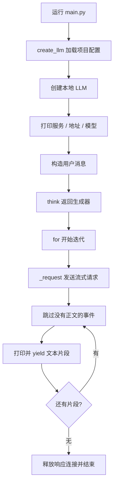

# LLM 源码与执行流程分析

核对日期：2026-10-17。本文以本地 `core/llm.py`、`main.py` 和调用它们的 Agent 为依据。模型客户端、Agent、消息、配置和注册表均由项目自行实现。

配置填写见 [模型服务配置与切换说明](模型服务配置与切换说明.md)，上层循环见 [Agent 设计与执行流程](Agent设计与执行流程.md)。

## 1. 当前调用关系

```text
main.py / Agent
  → create_llm() 读取所选服务配置
  → 本地 LLM
  → OpenAI Python SDK
  → base_url 指定的模型服务
```

OpenAI SDK 是请求兼容接口的通信依赖，不负责选择服务商、下载模型或维护对话历史。本地类名为 `LLM`。

## 2. 工厂与客户端分工

| 组件 | 职责 |
|---|---|
| `create_llm()` | 加载环境和JSON，选中同一服务的模型、地址与密钥 |
| `LLM.__init__()` | 保存连接与生成参数，创建SDK客户端 |
| `LLM._request()` | 组合默认参数与调用选项，发送请求 |
| `LLM.invoke()` | 返回完整回答文本 |
| `LLM.think()` | 流式打印并返回文本片段 |
| `LLM.stream_invoke()` | 将参数和片段转交给think |
| `LLM.close()` | 关闭SDK持有的连接 |

工厂按显式参数或JSON默认值选择配置，没有服务商自动检测。直接构造 `LLM` 时必须传入 `model`、`api_key`、`base_url`、`provider`。

```python
from core.llm import LLM, create_llm

llm = create_llm()
# 也可显式选择配置组
llm = create_llm(provider="ollama", model="qwen3.5:4b")
```

`llm: LLM` 是类型注解，不会创建额外实例或改变调用目标。

## 3. 从main.py到流式请求



main.py 的代码位于模块顶层，导入该模块也会执行请求流程。它不创建 Agent；Agent 示例由 `examples` 下的对应入口编排。

## 4. 初始化与请求参数

客户端保存 `model`、`provider`、`base_url`、`api_key`、`temperature`、`max_tokens` 和 `timeout`。默认温度为0.7，max_tokens默认不指定；timeout未显式传入时读取 `LLM_TIMEOUT`，否则默认60秒。

构造SDK客户端不等于请求成功，不会验证模型是否存在或密钥是否有效。

`_request()` 先放入实例的模型、消息、温度及可选max_tokens，再以调用选项覆盖，最后由调用入口固定stream模式。没有统一异常包装，也不从其他服务环境变量补模型、地址或密钥。

常用覆盖方式：

```python
answer = llm.invoke(messages, temperature=0, max_tokens=200)
for chunk in llm.stream_invoke(messages, temperature=0.2, max_tokens=200):
    pass
```

当前调用选项也可以覆盖请求中的model；这不改变实例属性。日常切换模型优先通过 `create_llm(provider=..., model=...)`，让显示信息与实例选择一致。

## 5. 三种调用入口

| 方法 | 返回内容 | 是否内部打印 | 请求时机 |
|---|---|---|---|
| `invoke()` | 完整字符串；无正文时返回空串 | 否 | 调用时 |
| `think()` | 文本生成器 | 是 | 开始迭代时 |
| `stream_invoke()` | 委托think的文本生成器 | 是 | 开始迭代时 |

`invoke()` 传入 `stream=True` 会抛出ValueError，提示使用流式入口。它只返回 `message.content`，不返回原生工具调用或完整响应对象。

`think()` 从SDK事件的第一项choice中取 `delta.content`。没有choices的用量事件和没有正文的角色、结束事件被跳过；片段不保证对应一个字或一句话。

`stream_invoke()` 会转交全部调用选项，不再只转发温度。

## 6. 生成器与完整文本

```python
response = llm.think(messages)  # 尚未发送请求
for chunk in response:
    pass  # think内部已经打印正文
```

需要保存或解析结果时：

```python
response_text = "".join(llm.think(messages))
```

这仍然是流式请求，只是调用方把收到的片段收集为完整字符串。不能直接对生成器使用split，也不能把生成器对象当作最终答案。

`yield` 返回一个片段并暂停函数，下一次迭代继续。外层再次打印chunk会重复输出；消费完的同一生成器不会自动重发请求。

## 7. 连接与异常

流式响应使用上下文管理器，在正常耗尽、流内异常或生成器关闭时释放连接。提前停止后仍持有生成器时，可显式调用 `response.close()`；单纯break不保证立即执行生成器清理。

整个客户端不再使用时可调用 `llm.close()` 释放SDK连接。当前没有提供自动管理客户端生命周期的Agent接口。

SDK请求错误直接传播，不再统一转换为项目异常。流式错误在迭代处发生；终端打印发生在请求之前，编码错误也可能早于网络调用。

| 表现 | 检查方向 |
|---|---|
| 401认证失败 | 所选地址对应的密钥与进程环境值 |
| 模型ID无效 | 当前服务实际支持的模型ID |
| 连接失败或超时 | 地址、端口、服务状态与网络 |
| 生成器没有split | 是否遗漏消费和拼接文本 |
| 正文重复 | 外层是否重复打印chunk |
| Windows终端编码错误 | 使用 `python -X utf8` 运行 |

## 8. 上层使用和验证范围

LLM不保存聊天历史。SimpleAgent和ReActAgent使用本地Agent历史；ReflectionAgent维护执行与反思记录；PlanAndSolveAgent把步骤结果拼入下一轮提示词。

`tests/test_llm.py` 离线覆盖配置、参数传递、生成器延迟执行、空事件、异常和关闭行为。相关离线测试在禁止导入教程框架时通过，不代表远端服务当前可用。

返回 [文档导航](文档导航.md)。
