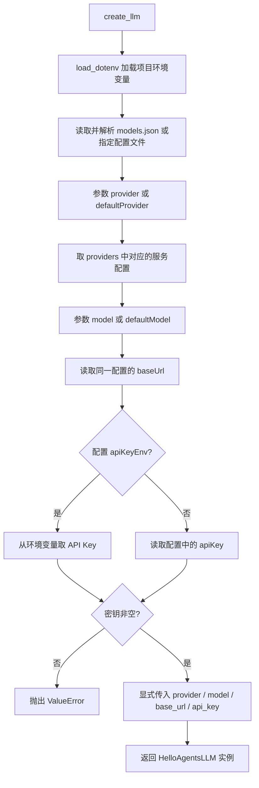
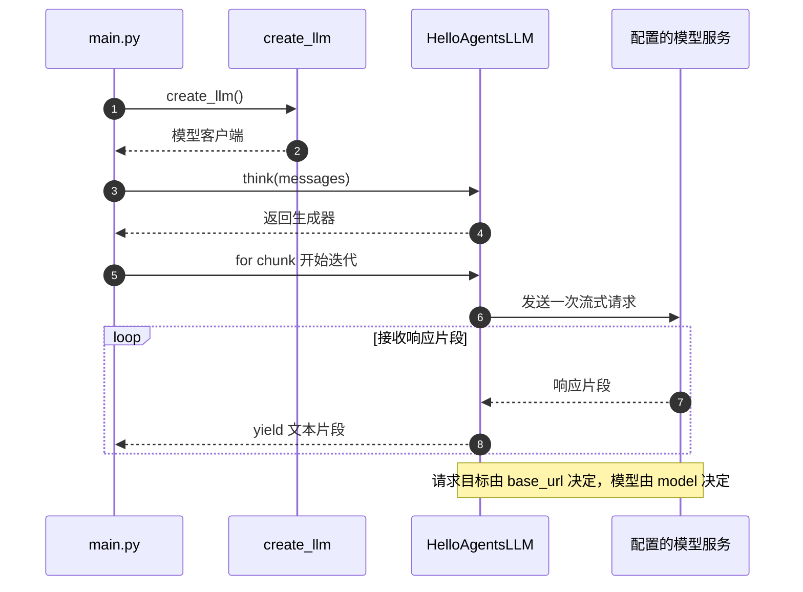
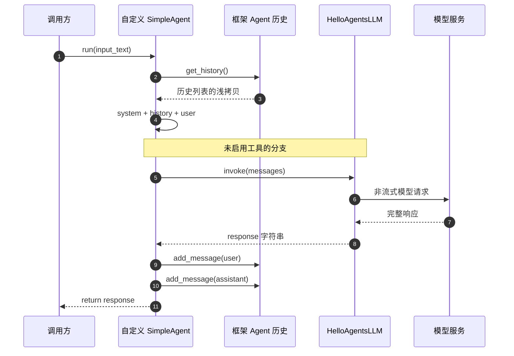
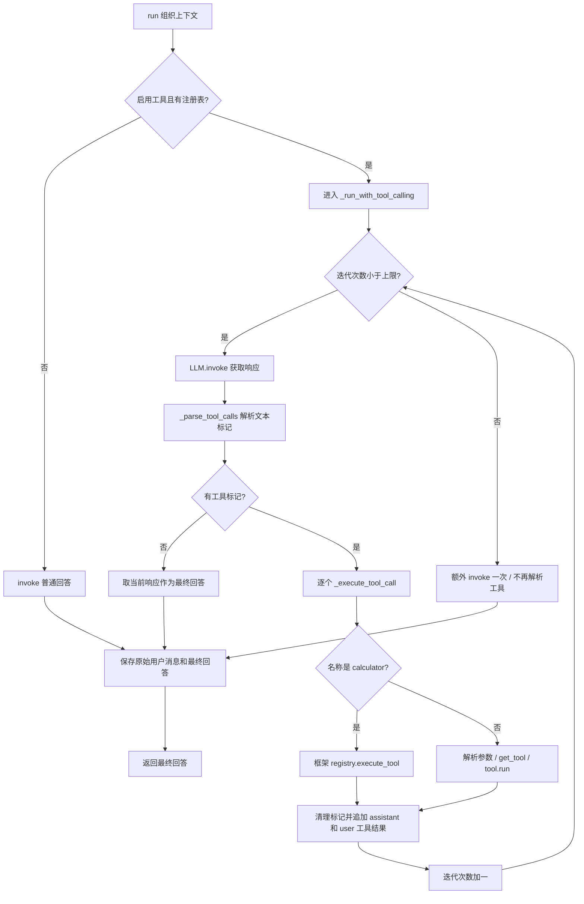
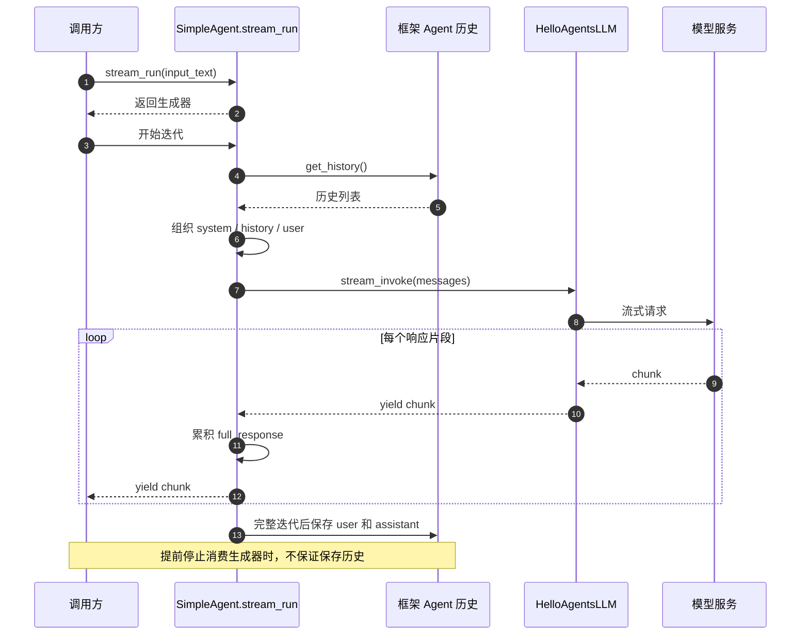
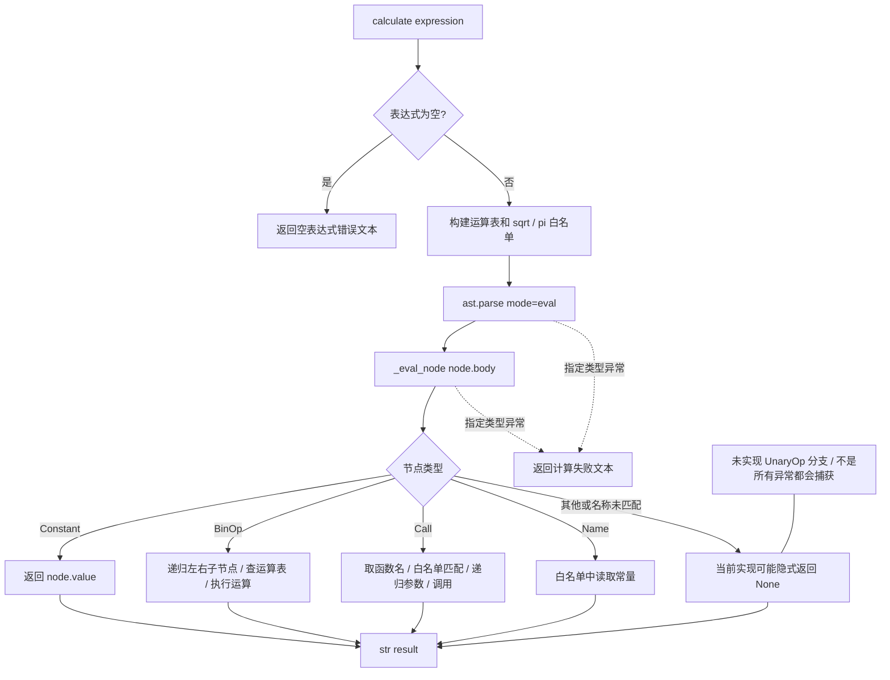
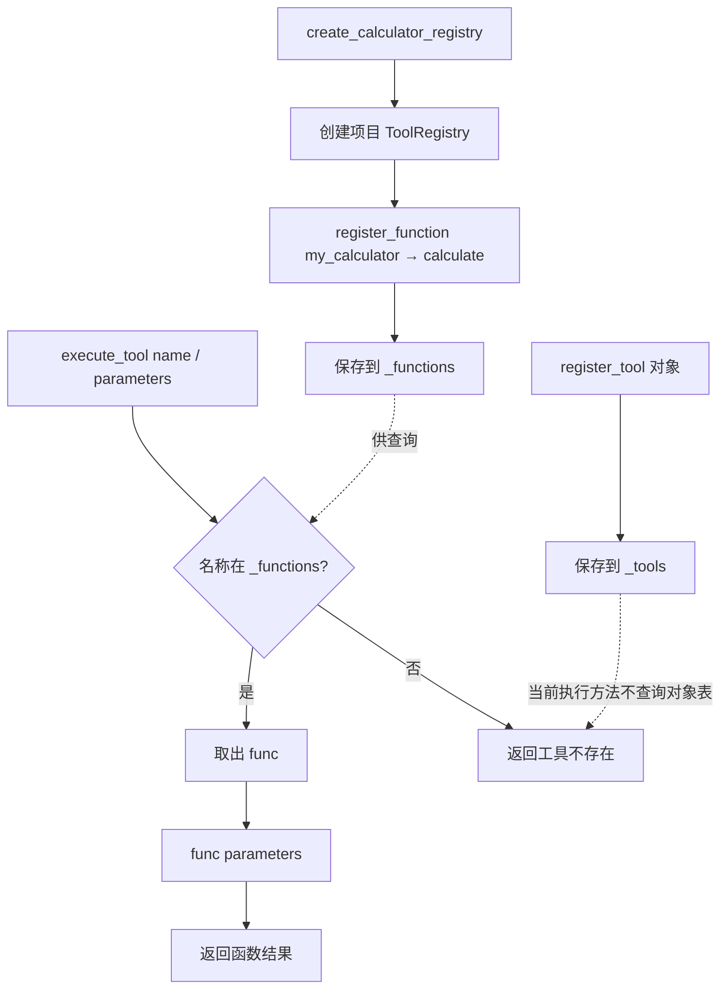

# 核心代码流程

核对日期：2026-10-16。这些图描述当前源码的静态执行路径，不是运行日志。前端通过 `web/flows.json` 提取本文的 Mermaid 代码块；修改图后运行 `python web/generate_sources.py` 更新索引。

阅读背景见 [Agent 设计与执行流程](../Agent设计与执行流程.md) 与 [LLM 源码分析](../HelloAgentsLLM源码与执行流程分析.md)。本文按源码分支展开，项目整体结构以入口文档为准。

前七个 Mermaid 图块按 0–6 编号被前端引用，保持顺序；新增图应同时维护 `web/flows.json`。计算器编排时序图独立维护在 [计算器工具调用流程](../计算器工具调用流程.md)。

## 1. 模型配置解析

`core/llm.py:create_llm` 显式解析同一服务的模型、地址和密钥，再创建框架客户端。未提供的 JSON 键会按 Python 原有行为报错；当前函数没有额外的配置结构校验。

## 2. main 的流式请求

`main.py` 直接使用模型客户端，没有经过 Agent 或工具注册表。`think()` 是生成器，实际请求发生在迭代时；它自身也打印输出，调用方再次打印可能重复。

## 3. SimpleAgent 普通对话

这是自定义 `agents/simple_agent.py` 的无工具分支；历史方法和 Message 来自安装的框架，与项目 `core/agent.py` 不同。

## 4. SimpleAgent 工具循环

当前实现解析文本协议 `[TOOL_CALL:工具名:参数]`，不是原生 function calling。达到迭代上限后补充的一次回答不会再次解析工具标记。

## 5. SimpleAgent 流式对话

流式方法当前不执行工具循环。调用方若提前停止迭代，方法尾部保存历史的代码尚未执行。

## 6. 计算器递归求值

`ast.parse` 只解析语法树。求值由项目 `_eval_node` 自行递归完成。运算表虽然包含正负号，但当前没有 `UnaryOp` 分支；未匹配的节点可能返回 None。图保留这个实际边界。

## 7. 本地注册表

这里是项目 `tools/registry.py`，不是框架同名类。对象能注册，但 `execute_tool()` 当前只查找函数表。`to_openai_schema()` 所需的 get_parameters、name、description 不在本类中定义，暂不视为可工作的接入路径。

## 维护核对

- 流式文本必须消费生成器后再做解析或保存，不能直接把生成器当字符串。
- 图中 SimpleAgent 使用框架历史与注册表，本地计算器使用本地注册表，路径需分别核对。
- 这些图只覆盖列出的核心场景，ReflectionAgent、ReActAgent、PlanAndSolveAgent 的循环说明见 [Agent 设计与执行流程](../Agent设计与执行流程.md)。

返回 [文档导航](../文档导航.md)。
