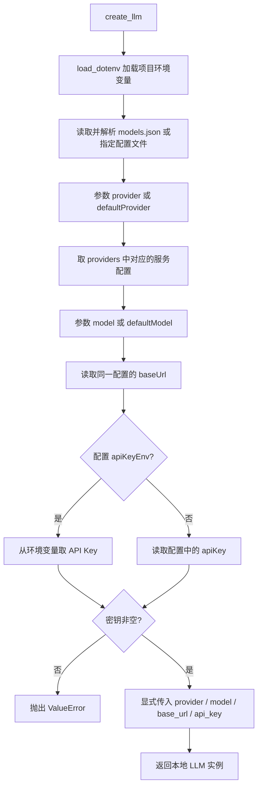
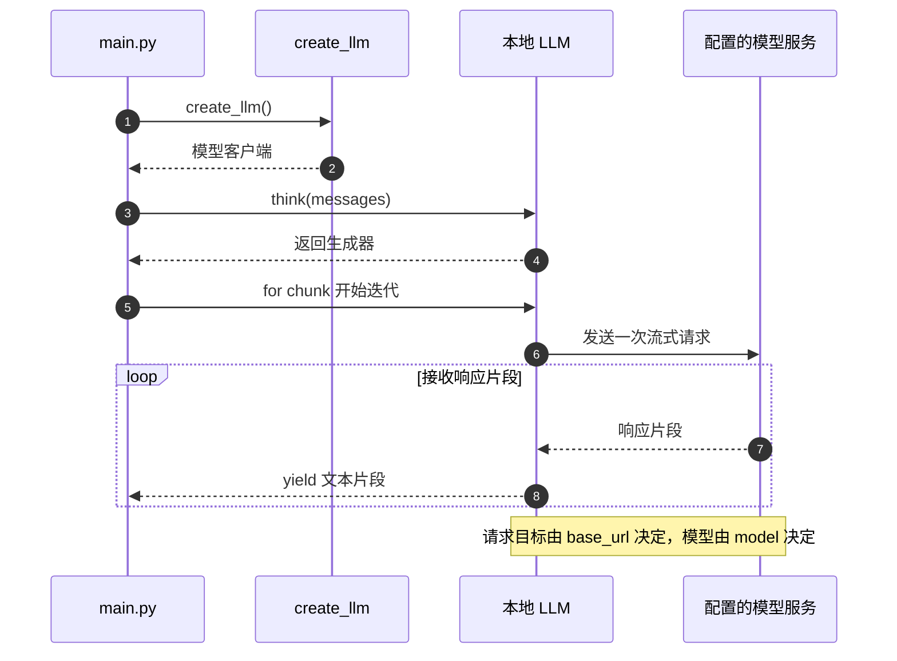
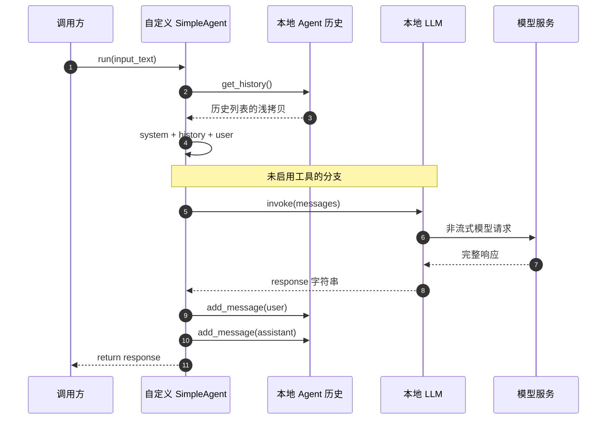
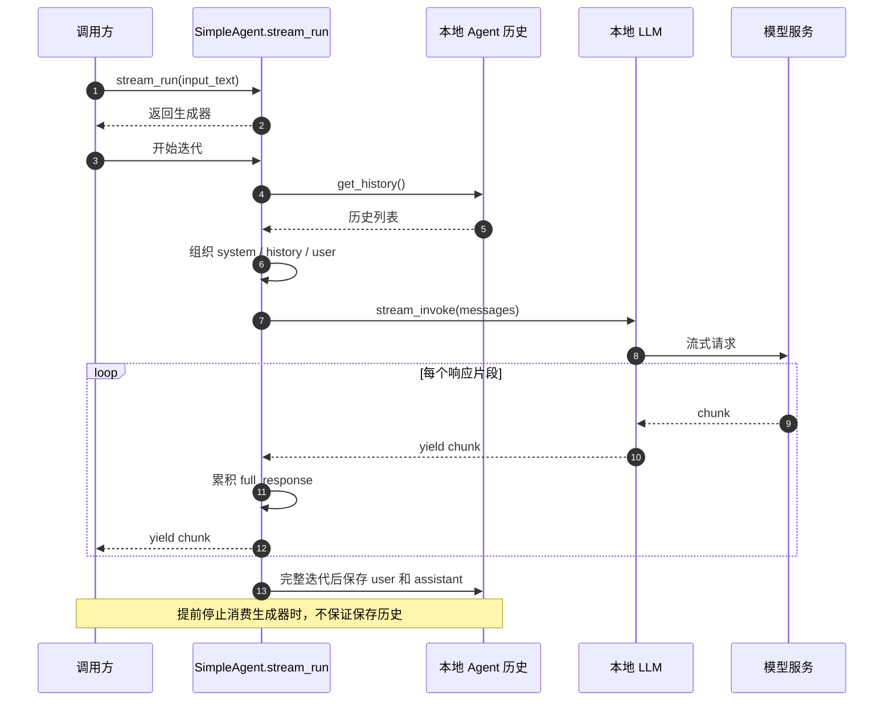
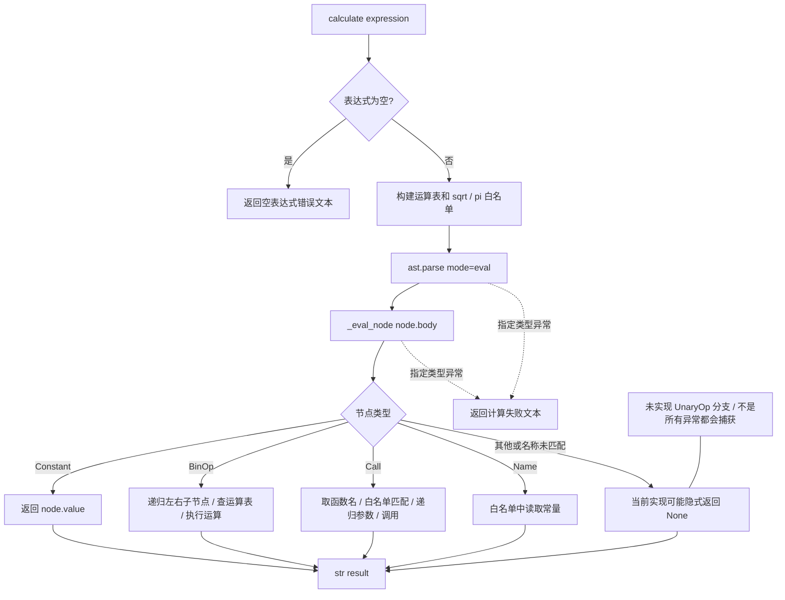
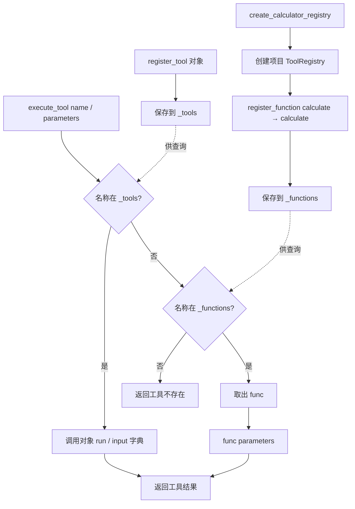
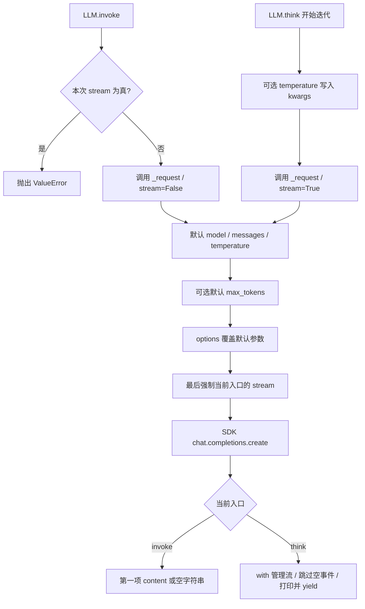
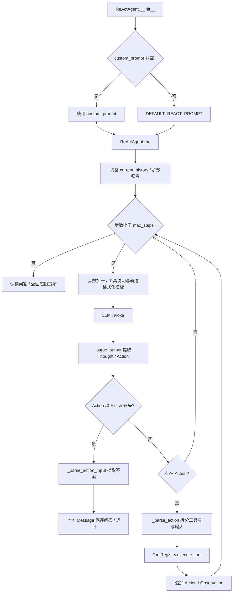
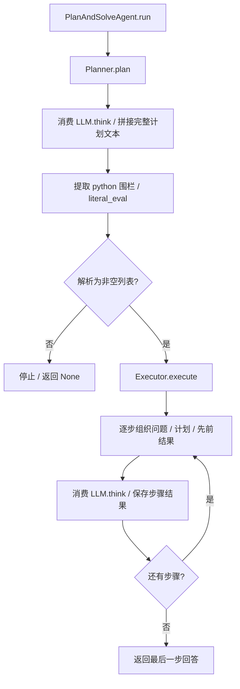
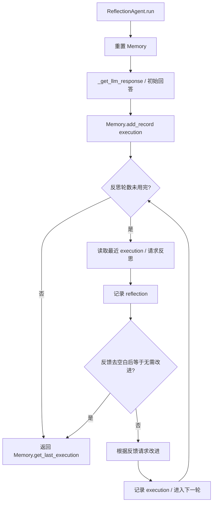

# 核心代码流程

核对日期：2026-10-17。这些图描述当前源码的静态执行路径，不是运行日志。前端通过 `web/flows.json` 提取本文的 Mermaid 代码块；修改图后运行 `python web/generate_sources.py` 更新索引。

阅读背景见 [Agent 设计与执行流程](../Agent设计与执行流程.md)、[LLM 源码与执行流程分析](../LLM源码与执行流程分析.md) 与 [本地 LLM 源码](../../core/llm.py)。本文按源码分支展开，项目整体结构以入口文档为准。

前七个 Mermaid 图块按 0–6 编号被前端引用，后续图块用于请求参数与其他 Agent；新增图应同时维护 `web/flows.json`。计算器编排时序图独立维护在 [计算器工具调用流程](../计算器工具调用流程.md)。

## 1. 模型配置解析

`core/llm.py:create_llm` 显式解析同一服务的模型、地址和密钥，再创建本地 LLM 客户端。未提供的 JSON 键会按 Python 原有行为报错；当前函数没有额外的配置结构校验。

## 2. main 的流式请求

`main.py` 直接使用模型客户端，没有经过 Agent 或工具注册表。`think()` 是生成器，实际请求发生在迭代时；它自身也打印输出，调用方再次打印可能重复。

## 3. SimpleAgent 普通对话

这是 `agents/simple_agent.py` 的无工具分支；继承本地 `core/agent.py` 的 Agent，使用本地 Message 和 Config。

## 4. SimpleAgent 工具循环

当前实现解析文本协议 `[TOOL_CALL:工具名:参数]`，不是原生 function calling。达到迭代上限后补充的一次回答不会再次解析工具标记。

## 5. SimpleAgent 流式对话

流式方法当前不执行工具循环。调用方若提前停止迭代，方法尾部保存历史的代码尚未执行。

## 6. 计算器递归求值

`ast.parse` 只解析语法树。求值由项目 `_eval_node` 自行递归完成。运算表虽然包含正负号，但当前没有 `UnaryOp` 分支；未匹配的节点可能返回 None。图保留这个实际边界。

## 7. 本地注册表

这里是项目 `tools/registry.py`。`execute_tool()` 先查询对象表，再查询函数表，对象与函数同名时优先对象。`to_openai_schema()` 所需的 get_parameters、name、description 不在本类中定义，暂不视为可工作的接入路径。

新增高级搜索工厂也使用同一注册机制，将名称 `advanced_search` 映射到实例的 `search` 绑定方法；下图以计算器为例，函数调度路径相同。它们的工厂分别创建新注册表，不会自动合并。

## 8. LLM 统一请求

`invoke()` 和 `think()` 共用 `_request()`。调用选项覆盖默认值后，stream 再由入口强制指定。构造参数 timeout 传给 SDK；请求异常直接传播，不进行框架包装。

## 9. ReAct 推理与行动

本地 ReActAgent 直接继承本地 Agent。构造时使用非空 `custom_prompt`，否则回退 `DEFAULT_REACT_PROMPT`；之后每次 `run()` 沿用选定模板。每轮提示词包括工具描述、问题与本轮 Action / Observation；`system_prompt` 和已存问答未单独加入模型消息。无 Action 也消耗步数，工具抛出的异常不会在本循环内统一捕获。

## 10. 先规划再求解

PlanAndSolveAgent 是组合 Planner 和 Executor 的独立类，不继承 Agent。执行步骤是模型解答，不是实际工具执行；最终返回最后一步回答，不额外汇总。

## 11. 反思与改进

ReflectionAgent 每次运行重置 Memory。execution 是生成内容，不表示执行了生成代码；反思由同一个模型完成。

## 维护核对

- 流式文本必须消费生成器后再做解析或保存，不能直接把生成器当字符串。
- SimpleAgent 与 ReActAgent 使用同一套本地 Agent、Message、Config、LLM 与注册表。
- 这些图只覆盖列出的核心场景，ReflectionAgent、ReActAgent、PlanAndSolveAgent 的循环图已加入上文，职责说明见 [Agent 设计与执行流程](../Agent设计与执行流程.md)。
- 新增搜索流程见 [搜索工具与测试说明](../搜索工具与测试说明.md)，顺序和并发编排见 [工具链与异步执行说明](../工具链与异步执行说明.md)；它们的主要流程已登记到前端场景索引。

返回 [文档导航](../文档导航.md)。
