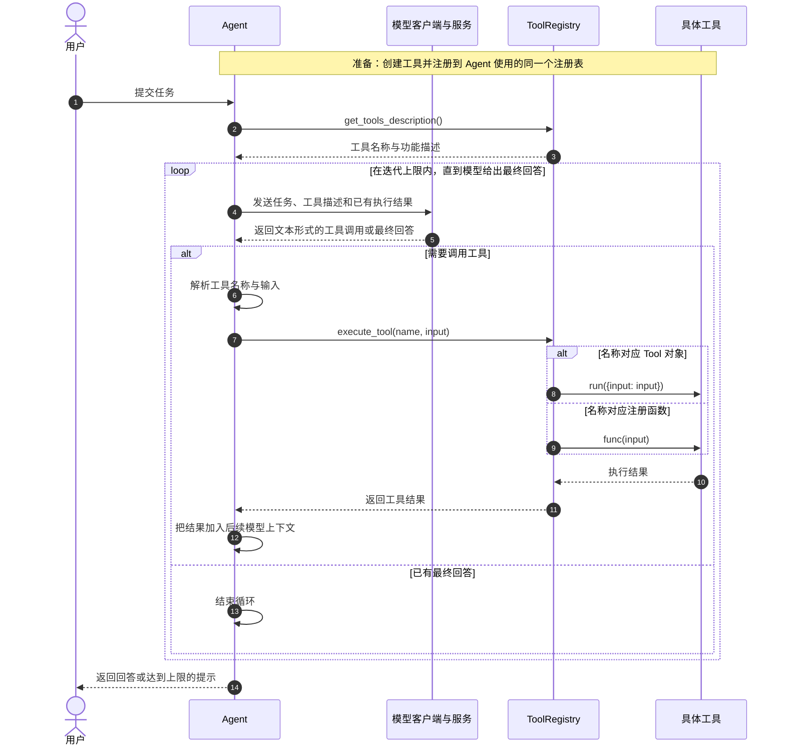
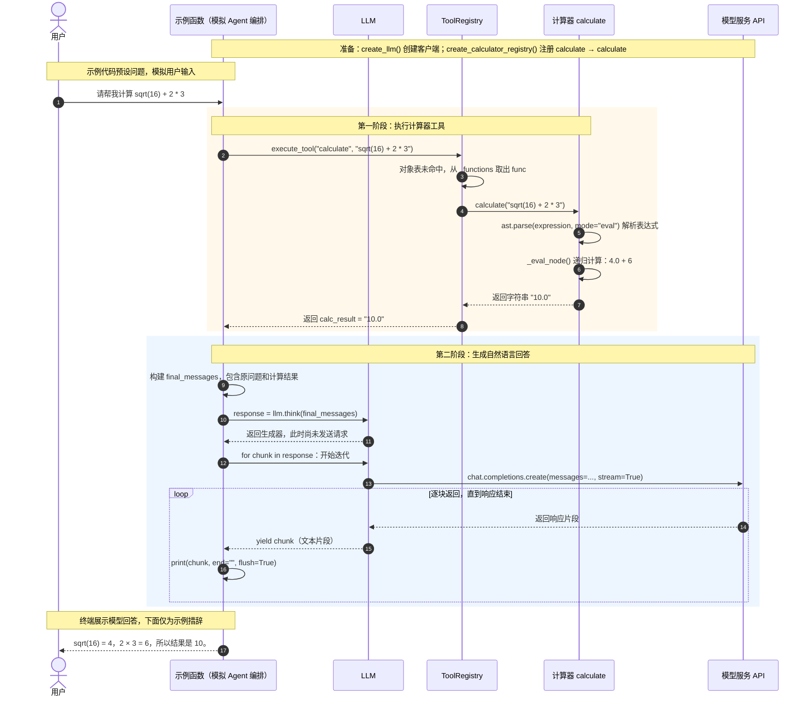

# 工具调用流程

本文说明当前项目中工具从注册、选择、执行到结果回传的通用流程。计算器、搜索等工具的具体实现不同，但都需要明确工具名称、输入和执行入口。核对日期：2026-10-17。

## 整体流程

下图以通过 `ToolRegistry.execute_tool()` 调度的 Agent 为例，对应当前 ReActAgent 的主要路径。工具注册在运行前完成，模型只提出调用意图，实际 Python 函数由应用执行。

工具不一定由模型选择。测试函数、工具链和并发执行器也可以直接指定工具名称与输入，跳过模型选择环节；执行结果也可以直接返回给调用方，不必再交给模型。

## 各组件负责什么

| 组件 | 对应代码 | 职责 |
|---|---|---|
| Agent | `agents/simple_agent.py`、`agents/react_agent.py` | 组织上下文、解析调用意图、执行工具并回传结果 |
| 模型客户端 | `core/llm.py` 的 `LLM` | 向配置的模型服务发送请求，返回文本 |
| 工具注册表 | `tools/registry.py` 的 `ToolRegistry` | 保存名称与实现的映射，提供查询与执行入口 |
| 对象工具 | `tools/base.py` 的 `Tool` 子类 | 通过 `run(parameters)` 执行，通过 `get_parameters()` 描述参数 |
| 函数工具 | 注册的 Python 函数或绑定方法 | 接收字符串输入并返回字符串结果 |

工具是能力的执行者。例如计算器在本地求值，搜索工具请求外部搜索服务；是否联网取决于工具自身实现。

## 注册与调用的两种形式

注册只保存对象或函数，不会立即执行工具。

| 形式 | 注册方式 | 统一字符串入口的执行方式 |
|---|---|---|
| 对象工具 | `registry.register_tool(tool)` | `execute_tool(name, text)` 调用 `tool.run({"input": text})` |
| 函数工具 | `registry.register_function(name, description, func)` | `execute_tool(name, text)` 调用 `func(text)` |

同名时，对象工具优先。`get_tool(name)` 只查询对象工具；`list_tools()` 和 `get_tools_description()` 覆盖两种形式。名称不存在时，`execute_tool()` 返回“工具不存在”文本；工具内部抛出的异常由调用方决定如何处理，注册表不统一捕获。

多参数对象工具可以先通过 `get_tool(name)` 获取对象，再调用 `run({参数名: 参数值})`。当前统一入口只包装 `input` 字段，不会自动把任意字符串转换成多参数字典，也不会自动校验所有参数。

工具必须注册到调用方实际持有的注册表中。新建另一个注册表，不会自动共享或合并工具。

## 当前 Agent 的实际差异

| 调用方 | 选择与解析 | 执行入口 |
|---|---|---|
| ReActAgent | 用提示词约定 Action 等文本格式，再解析名称和输入 | 统一调用 `execute_tool(name, input)`，将结果作为 Observation 回传模型 |
| SimpleAgent | 用提示词约定工具调用文本，再由 `_parse_tool_calls()` 解析 | `calculator` 走 `execute_tool()`；其他名称解析参数后通过 `get_tool()` 获取对象，再调用 `run()` |
| 测试或普通业务代码 | 由代码明确指定名称与输入 | 可以直接调用注册表，无需先请求模型 |
| 工具链与并发执行器 | 由步骤配置或任务列表指定名称与输入 | 通过注册表执行；分别负责顺序上下文传递与并发调度 |

因此，注册成功不表示所有 Agent 都能按同一路径调用。SimpleAgent 当前的通用分支只查询对象表，函数工具即使已注册，也不能据此认定已适配该分支。ReflectionAgent 和 PlanAndSolveAgent 当前没有工具调用循环。

当前 Agent 使用提示词约束和文本解析，并未接入 OpenAI 原生 `tools` / `tool_calls` 协议。注册表中的 `to_openai_schema()` 还引用了注册表自身未定义的属性与方法，不能作为原生 Function Calling 已可用的依据。

## 示例：工具执行后再生成回答

以下保留计算器示例，展示“代码指定工具 → 执行 → 把结果交给模型”的具体过程，对应 `examples/calculator_demo.py` 的 `demo_calculator_with_llm()`。该函数模拟编排，没有创建 SimpleAgent；表达式由示例代码指定，不是模型自动选择的参数。

`calculate` 是函数工具的注册名称；`calculator` 是 CalculatorTool 对象的注册名称。两者最终都委托本地 `calculate()` 求值，但不是同一个注册项。数学表达式解析属于计算器内部逻辑，不是所有工具都需要的步骤。

示例中的 `think()` 返回生成器，迭代后才发起请求；每个 `chunk` 是一段文本。当前 `think()` 自身会打印内容，测试再次打印同一片段时会出现重复输出。请求目标由模型配置决定，使用 OpenAI 兼容接口不代表一定请求 OpenAI 服务。

## 新增工具时需要确认什么

1. 定义清晰的名称、描述和输入格式，选择对象工具或函数工具。
2. 实现执行逻辑，并注册到实际使用的注册表。
3. 确认调用方支持该注册形式，必要时适配参数解析。
4. 把执行结果或错误反馈给调用方；Agent 再根据结果继续推理或回答。
5. 分别验证工具自身执行和 Agent 调用链，不能仅凭最终回答正确判断工具成功。

当前计算器测试示例主要打印结果，不能证明每次都成功调用了工具；搜索后端成功也不代表 Agent 集成已验证。具体执行路径应结合工具结果与对应测试判断。

搜索实现见 [搜索工具与测试说明](搜索工具与测试说明.md)，顺序与并发编排见 [工具链与异步执行说明](工具链与异步执行说明.md)，Agent 循环见 [Agent 设计与执行流程](Agent设计与执行流程.md)。返回 [文档导航](文档导航.md)。
