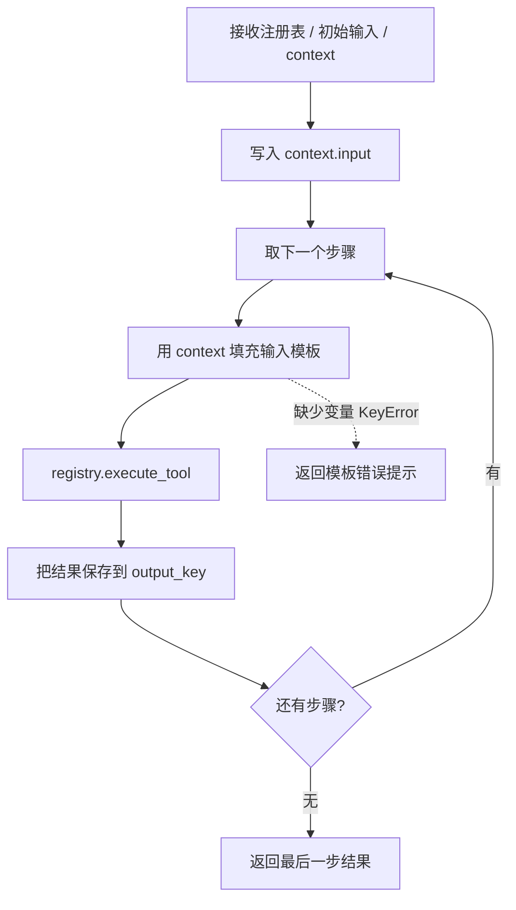
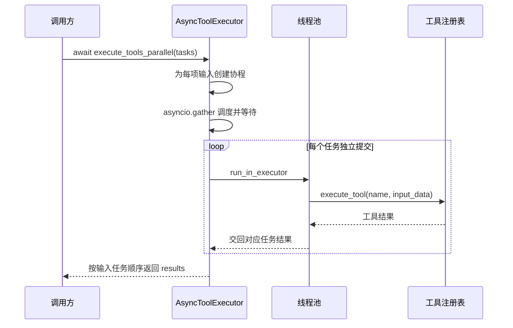

# 工具链与异步执行说明

核对日期：2026-10-16。依据 `tools/chain.py`、`tools/async_executor.py`、本地注册表及现有工具整理。两者都已编写实现，不再是空白占位文件，但尚未与现有 Agent 形成完整接入流程。

## 1. 选择顺序还是并发

| 组件 | 适用任务 | 数据如何传递 | 返回值 |
|---|---|---|---|
| ToolChain | 后一步依赖前一步 | `context` 与输入模板 | 最后一步结果 |
| ToolChainManager | 管理多条命名工具链 | 交给选定工具链执行 | 该工具链结果 |
| AsyncToolExecutor | 多个任务互不依赖 | 每个任务自带输入 | 按输入顺序排列的结果列表 |

它们都调用注册表的 `execute_tool()`，不负责判断用户意图，也不会自行调用 LLM。工具调用顺序、名称和输入由开发者给定；现有 Agent 源码未调用这两个模块。

## 2. ToolChain：步骤定义

`__init__()` 保存名称、描述和空的 `steps` 列表。`add_step()` 只保存配置，不执行工具：

```python
chain.add_step(
    tool_name="calculate",
    input_template="{input}",
    output_key="first_result",
)
```

| 字段 | 含义 |
|---|---|
| `tool_name` | 注册表里要查找的名称 |
| `input_template` | 工具输入，可引用上下文中的变量 |
| `output_key` | 当前结果在上下文中的名称 |

不填写 `output_key` 时按添加前的步骤数生成名称，因此第一步默认为 `step_0_result`，与日志从 1 开始编号不同。

## 3. ToolChain.execute() 的流程



`input_template.format(**context)` 将字典展开为命名参数。例如 `context={"first": "5"}`，模板 `"{first} * 2"` 就变为 `"5 * 2"`。

只使用当前计算器即可说明数据传递：

```text
步骤一：calculate，输入模板 {input}，输出键 first
步骤二：calculate，输入模板 {first} * 2，输出键 second
初始输入：2 + 3
执行结果：5 → 10，最终返回字符串 "10"
```

这是机制示例。`chain.py` 当前通过 `tools.registry` 导入本地注册表；图示不代表已执行网络搜索或真实模型验证。

## 4. ToolChainManager

| 方法 | 职责 |
|---|---|
| `register_chain(chain)` | 按 `chain.name` 放入 `chains` 字典，同名会覆盖 |
| `execute_chain(name, input_data, context)` | 查找工具链并传入管理器持有的注册表 |
| `list_chains()` | 返回已注册的工具链名称 |

注册表管理单个工具，管理器管理整条工具链。注册工具链不会自动把它变成可供 Agent 调用的注册表工具。

## 5. 现有研究工具链为什么尚未闭环

`create_research_chain()` 实际只有两个步骤：

```text
search：接收用户输入 → search_result
calculate：接收“根据以下信息计算相关数值:...” → calculation_result
```

当前缺少的关联包括：

- 工厂只定义链条，没有创建注册表或注册搜索、计算器。
- 搜索步骤名为 `search`，高级搜索工厂注册名为 `advanced_search`；两者不自动匹配。
- 计算器只接受数学表达式，不能直接理解“根据以下信息计算相关数值”或搜索摘要；需要另行提取、转换为表达式。
- 文档字符串写“搜索 → 计算 → 总结”，但源码没有总结步骤。

运行时还需注意：空步骤列表会在取最后一步时报错；模板只捕获缺少变量的 KeyError，其他格式错误可能直接抛出；工具返回错误字符串仍会继续；工具抛出的异常则没有统一捕获。日志用 `len(result)`，要求工具返回能取长度的结果。

`context = context or {}` 会替换传入的空字典，而非空字典会被直接修改；`input` 和已有同名输出键可能被覆盖。当前没有自动回滚或结果类型转换。

## 6. AsyncToolExecutor：把同步工具交给线程池

`__init__()` 保存注册表并创建 `ThreadPoolExecutor(max_workers=4)`，默认最多四个线程并发执行，多出的任务排队。

核心代码：

```python
async def execute_tool_async(self, tool_name, input_data):
    loop = asyncio.get_event_loop()

    def _execute():
        return self.registry.execute_tool(tool_name, input_data)

    result = await loop.run_in_executor(self.executor, _execute)
    return result
```

| 写法 | 作用 |
|---|---|
| `async def` | 定义协程函数，调用时得到协程对象 |
| `run_in_executor()` | 将同步函数提交给线程池 |
| `await` | 等待结果期间让事件循环处理其他协程 |
| `ThreadPoolExecutor` | 实际执行同步工具调用的工作线程 |

这适合等待网络的搜索等任务。给函数加 `async` 不会自动消除同步阻塞；这里真正把同步调用移出了事件循环线程的是 `run_in_executor()`。

多个任务并发发出可以缩短等待，但结果不会变成流式输出。当前方法等待收集完成后返回列表；也不能保证纯 Python 密集计算获得同样的加速。

## 7. execute_tools_parallel() 与结果顺序



图中每个任务的调用关系相同，各任务可在不同线程重叠执行，不要求前一个任务完成后再提交下一个。

任务结构为：

```python
tasks = [
    {"tool_name": "search", "input_data": "Python编程"},
    {"tool_name": "calculate", "input_data": "2 + 2"},
]
```

循环调用 `execute_tool_async()` 只创建协程；`await asyncio.gather(*async_tasks)` 才调度它们。结果按输入顺序返回，即使计算比搜索先完成，仍位于第二项。缺少 `tool_name` 或 `input_data` 会直接触发 KeyError。

计算依赖搜索结果时，不能把两者直接当作独立并发任务；应先取得所需结果，再执行下一阶段。

## 8. 注册表差异、资源与示例边界

AsyncToolExecutor 的注解和示例都使用本地 `tools.registry.ToolRegistry`。计算器与高级搜索工厂也返回该类，但每次工厂调用产生独立实例，不会自动合并注册项。

本地注册表对对象与函数工具异常均直接传播。返回错误文本时，`gather()` 不会把它当成异常；真正抛出异常时，默认 gather 会传播异常，其他已启动任务不保证停止。

`__del__()` 尝试调用 `shutdown(wait=True)`，但析构时机不确定，等待中的线程也可能影响退出。当前没有显式关闭接口、任务级超时或取消线程中同步请求的机制。多个线程共用注册表和工具实例时，也需要确认实例支持并发访问。

文件底部的 `test_parallel_execution()` 只是异步示例定义：

- 没有入口调用，直接执行文件不会自动运行它。
- 示例创建空注册表，没有真正注册注释所说的搜索和计算工具。
- 即使使用 `asyncio.run(test_parallel_execution())` 驱动，也不能在未注册工具时得到真实搜索与计算结果。
- 目前没有专门的工具链或异步执行测试文件；现有高级搜索测试也不覆盖它们。

搜索工具与环境配置见 [搜索工具与测试说明](搜索工具与测试说明.md)，计算器行为见 [计算器工具调用流程](计算器工具调用流程.md)。返回 [文档导航](文档导航.md)。
