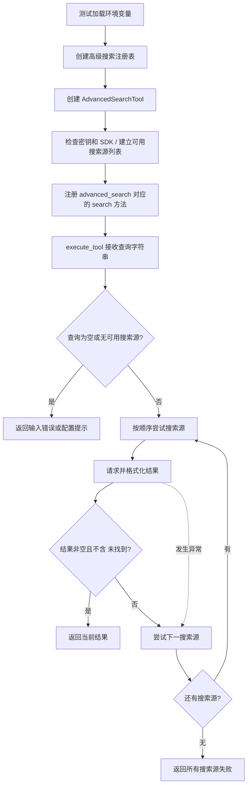

# 搜索工具与测试说明

核对日期：2026-10-16。依据 `tools/search_tool.py`、`tools/advanced_search.py`、`test/test_advanced_search.py` 和本地工具注册表整理。本次更新只核对源码，不发送真实搜索请求。

## 1. 两个搜索类的区别

| 项目 | SearchTool | AdvancedSearchTool |
|---|---|---|
| 文件 | `tools/search_tool.py` | `tools/advanced_search.py` |
| 类关系 | 计划继承本地 Tool 抽象类 | 独立类，不继承 Tool |
| 名称 | `search` | `advanced_search` |
| 对外入口 | 尚未实现 `run()` | `search(query)` |
| 后端选择 | 构造参数 `backend`，混合模式优先 Tavily | 根据可用搜索源依次尝试，Tavily 优先 |
| 本地注册 | 尚无注册工厂 | `create_advanced_search_registry()` 注册绑定方法 |
| 当前验证情况 | 类尚不具备完整运行条件 | 用户提供的运行输出已显示 Tavily 搜索成功 |

两个类没有继承或调用关系。虽然功能相近，也有同名或近似的内部方法，但它们当前是两套实现；修复其中一个，不会自动修复另一个。

`backend` 表示选择哪种搜索服务，`hybrid` 表示按代码中的规则选择和切换，不代表同时请求多个服务或合并结果。

## 2. AdvancedSearchTool 的执行流程



它先注册后调用，搜索请求发生在 `search()` 内，而不是注册工具时。

### 主要方法

| 方法 | 作用 |
|---|---|
| `__init__()` | 设置名称、描述，初始化搜索源 |
| `_setup_search_sources()` | 有密钥且能导入 SDK 时，登记 Tavily / SerpApi |
| `search(query)` | 检查输入，按顺序调用可用源，返回首个被判定可用的结果 |
| `_search_with_tavily(query)` | 调用 Tavily，格式化可选答案和前三条结果 |
| `_search_with_serpapi(query)` | 当前使用旧版 GoogleSearch 接口，格式化前三条结果 |
| `create_advanced_search_registry()` | 将 `search_tool.search` 作为函数注册到本地 ToolRegistry |

### 查询与注册表的关系

```python
registry.execute_tool("advanced_search", "Python编程语言的历史")
```

对应的调用链是：

```text
本地 ToolRegistry.execute_tool(name, parameters)
  → self._functions[name]["func"]
  → AdvancedSearchTool.search(query)
  → 调用选中的搜索服务
```

`parameters` 和 `query` 是不同函数中的参数名，调用时同一字符串按位置传递。注册时传入 `search_tool.search`，保存的是绑定到该实例的方法，不会立即执行搜索。

当前本地注册表可执行普通函数和绑定方法。AdvancedSearchTool 没有 `run()`、`get_parameters()`，所以当前使用的是函数工具路径，而不是完整 Tool 对象路径。

## 3. 密钥与环境加载

搜索使用 `TAVILY_API_KEY` 和 `SERPAPI_API_KEY`，与模型的 `DEEPSEEK_API_KEY`、`MODELSCOPE_API_KEY` 分开，不由 `models.json` 选择。

当前测试先调用 `load_dotenv()`，然后创建工具。工具本身只用 `os.getenv()` 读取进程环境变量，不主动加载 `.env`。因此删除加载语句且终端没有预设变量时，即使文件中有密钥，也会显示没有可用搜索源。

测试中的无参 `load_dotenv()` 使用库的默认查找方式；它不像 `create_llm()` 那样显式固定项目根目录路径。默认不覆盖已有同名进程变量，排查配置时要区分文件值和进程值，不要输出密钥正文。

当前 `.env.example` 尚未列出上述两个搜索变量。需要使用搜索时，在本地配置相应变量；模板后续可补空值变量名。本次仅记录差异，不修改模板或真实配置。

## 4. 初始化、结果格式与 SDK 差异

“搜索源已启用”目前表示密钥非空、SDK 可导入，Tavily 客户端能创建；不代表已经验证远端认证、额度或 SDK 的每个方法。

AdvancedSearchTool 的 Tavily 调用只指定 `query` 和 `max_results=3`，没有显式请求 `include_answer=True`，所以不能保证响应里有直接答案。

| 字段 | Tavily | SerpApi |
|---|---|---|
| 网页结果列表 | `results` | `organic_results` |
| 摘要 | `content` | `snippet` |
| 链接 | `url` | `link` |
| 可选直接答案 | `answer` | `answer_box` 中的答案或摘要 |

AdvancedSearchTool 当前输出标题和摘要，没有把来源链接加入文本；SearchTool 的格式化代码则包含来源链接。

本地环境此前确认提供新版 `serpapi.Client`，不提供 `serpapi.GoogleSearch`。SearchTool 新增的 `_search_serpapi()` 已使用 Client，而 AdvancedSearchTool 仍使用 GoogleSearch；后者实际走到 SerpApi 分支时存在接口不匹配问题。

## 5. SearchTool 当前未完成的部分

- 当前通过 `tools.base` 导入本地 Tool，包路径已对齐。
- 本地 Tool 是抽象类，SearchTool 未实现 `run()`、`get_parameters()`，因此尚不能正常实例化。
- 构造函数调用 `_setup_backends()`，但类中未定义；`tavily_client` 的初始化也尚未补齐。
- Tavily 的遍历写成 `enumerate(response.get('results', [][:3], 1))`，把 `1` 错传给 `dict.get()`，实际调用会报错；预期结构应是先取列表、截前三项，再给 enumerate 指定起始序号。
- `_search_serpapi()` 已实现查询与格式化，之前通过模拟响应验证，不等于整个 SearchTool 类或真实 SerpApi 请求已验证。
- `_search_hybrid()` 在 Tavily 失败后调用 SerpApi 的位置没有独立捕获其异常；不能认为所有分支都会稳定返回统一错误字符串。

这些是源码边界说明，不是本次已修复项目。

## 6. 如何理解当前测试输出

从项目根目录运行：

```powershell
python -X utf8 -m test.test_advanced_search
```

| 测试函数 | 实际执行内容 |
|---|---|
| `test_advanced_search()` | 注册工具，通过注册表执行三次查询 |
| `test_direct_search()` | 新建实例并搜索“机器学习算法” |
| `test_tool_description()` | 新建注册表并打印描述，没有创建 Agent |

若 Tavily 每次都返回可用结果，前两段合计执行四次 Tavily 搜索，SerpApi 不会被调用。第三段仅初始化与注册，不执行搜索。

用户提供的最近运行输出支持以下结论：环境变量已加载、本地注册调度已通、Tavily 返回真实网页结果。不能据此宣称 SerpApi、失败切换或 Agent 集成已通过。

当前判定只检查格式化字符串是否非空且不含“未找到”。即使网页列表为空，格式化标题也可能使它被当作成功；没有跨源质量评分、结果融合或去重。

“人工智能的最新发展”返回旧资料也不矛盾：当前没有显式时间筛选，搜索成功与结果时效性是两回事。展示的内容是检索摘要，不是模型完成事实核验后的回答。

工具串联与并发执行见 [工具链与异步执行说明](工具链与异步执行说明.md)。返回 [文档导航](文档导航.md)。
