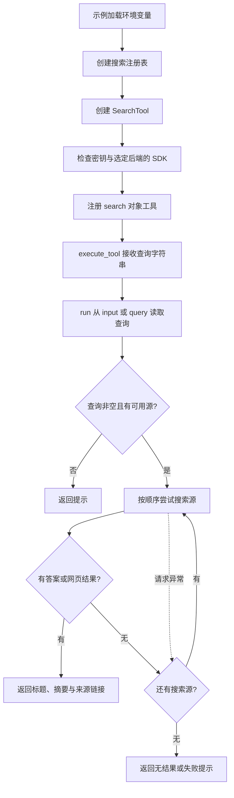

# 搜索工具与测试说明

核对日期：2026-10-17。搜索实现统一位于 `tools/search_tool.py`，对外提供继承本地 Tool 的 `SearchTool`。原先独立的高级搜索实现已整合，不再保留重复类或兼容别名。

## 搜索流程



初始化只创建客户端，不执行搜索。`hybrid` 模式优先 Tavily，空结果或请求失败时尝试 SerpApi；显式选择 `tavily` 或 `serpapi` 时只使用该后端。

这是固定优先级回退，不包含跨源结果融合、质量评分或自动时间筛选。搜索成功不代表摘要内容已经完成事实核验。

## 主要接口

| 接口 | 职责 |
|---|---|
| `SearchTool(backend="hybrid", tavily_key=None, serpapi_key=None)` | 选择后端，读取显式密钥或进程环境变量 |
| `_setup_backends()` | 初始化选定且已配置的 SDK，缺少可选 SDK 时跳过对应源 |
| `run(parameters)` | Tool 对象入口，读取 `query` 或 `input` |
| `get_parameters()` | 声明必需的字符串参数 `query` |
| `search(query)` | 校验空查询，按顺序搜索并处理回退 |
| `_search_tavily(query)` | 请求可选直接答案与前三条网页结果 |
| `_search_serpapi(query)` | 使用 `serpapi.Client` 查询 Google 并格式化结果 |
| `create_search_registry(backend="hybrid")` | 创建注册了 search 对象的新注册表 |

## 注册与调用

```python
from tools.search_tool import SearchTool, create_search_registry

registry = create_search_registry()
result = registry.execute_tool("search", "Python编程语言的历史")

tool = registry.get_tool("search")
result = tool.run({"query": "Python编程语言的历史"})
```

注册表把字符串包装为 `{"input": query}`，SimpleAgent 的现有参数解析则使用 `{"query": query}`。SearchTool 同时接受这两个入口，因此无需为此次搜索整合修改 Agent 的调度逻辑。ReActAgent 也可通过注册表执行该对象。

已有注册表可直接 `register_tool(SearchTool())`；工厂每次创建新注册表，不会自动合并其他工具。

## 配置与依赖

搜索密钥使用 `TAVILY_API_KEY` 和 `SERPAPI_API_KEY`，与模型服务配置分开，不通过 `models.json` 选择搜索后端。

```powershell
python -m pip install tavily-python serpapi
python -X utf8 -m examples.search_demo
```

只使用一个后端时，可以只安装对应 SDK。示例在直接运行时调用 `load_dotenv()`；工具本身只读取进程环境变量。`.env.example` 目前未列出搜索变量，需要使用时在本地添加相应密钥，不要提交真实配置。

SerpApi 统一使用提供 `Client` 的 `serpapi` 包，不再混用 `GoogleSearch` 接口。初始化成功只表示本地配置与 SDK 可用，不代表远端认证、额度或网络已验证。

## 结果与异常

| 字段 | Tavily | SerpApi |
|---|---|---|
| 网页列表 | `results` | `organic_results` |
| 摘要 | `content` | `snippet` |
| 来源 | `url` | `link` |
| 可选答案 | `answer` | `answer_box.answer` 或 `snippet` |

每个后端最多格式化三条网页结果。答案和列表都为空时返回空字符串，由 `search()` 决定是否尝试下一源；不通过匹配“未找到”等正文判断成功。

不支持的后端名称抛出 `ValueError`。空查询、无可用源、所有源无结果或失败时返回提示文本。后端异常日志仅记录后端名与异常类型，不直接打印可能携带凭证的异常正文。

## 示例与离线测试

`examples/search_demo.py` 提供注册表查询、直接查询和描述展示，直接运行会访问真实搜索服务，导入模块不会执行请求。

`tests/test_search_tool.py` 模拟 SDK，不访问网络，覆盖：

- 对象注册、query/input 参数适配和来源链接。
- Tavily 空结果或异常时回退到 SerpApi。
- 显式后端、无密钥、缺少可选依赖和无效后端。
- 全部后端失败的提示，以及日志不输出凭证。
- SimpleAgent 的实际工具循环接收搜索结果。
- 导入示例不会创建模型或搜索客户端。

```powershell
python -X utf8 -m pytest tests -q
```

离线测试通过不等于真实 Tavily、SerpApi 服务当前可用。本次整合未发起真实模型或搜索请求。

工具通用机制见 [工具调用流程](工具调用流程.md)，串联与并发执行见 [工具链与异步执行说明](工具链与异步执行说明.md)。返回 [文档导航](文档导航.md)。
