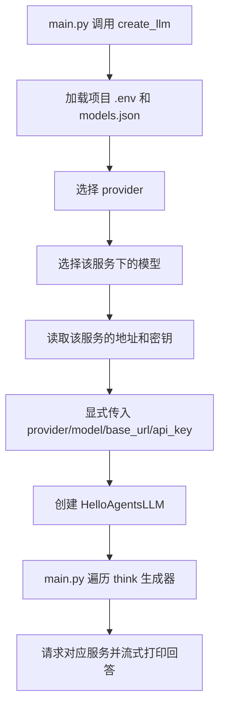

# 模型服务配置与切换说明

本项目借鉴 Pi 的按服务商分组配置方式：先选择服务商和模型，再读取该组地址和密钥，最后显式创建 `HelloAgentsLLM`。这是项目自己的配置格式，不是 Pi 配置文件的完整实现。

核对日期：2026-10-16。本文说明当前项目配置；客户端内部行为见 [HelloAgentsLLM 源码与执行流程分析](HelloAgentsLLM源码与执行流程分析.md)。

## 文件职责

| 文件 | 职责 |
|---|---|
| `models.json` | 服务列表、接口地址、模型列表、默认选择、密钥来源 |
| `.env` | 本地真实密钥，不提交 Git |
| `.env.example` | 不含真实密钥的配置模板，可提交 Git |
| `core/llm.py` | `create_llm()` 配置工厂，读取一组配置并创建客户端 |
| `main.py` | 创建客户端、打印实际配置、调用模型 |

安装包源码不作修改。原自定义 `LLM` 子类已被配置工厂替代，项目不再使用该子类。

## 当前默认配置

`models.json` 中 `defaultProvider` 为 `deepseek`。下表仅记录当前仓库配置，不表示已实时验证服务端支持情况。

| 服务配置名 | 默认模型 | 请求地址 | 密钥来源 |
|---|---|---|---|
| `deepseek` | `deepseek-flash` | `https://api.deepseek.com` | `DEEPSEEK_API_KEY` |
| `ollama` | `qwen3.5:4b` | `http://localhost:11434/v1` | 配置中的占位值 `ollama` |
| `modelscope` | `deepseek-ai/DeepSeek-V4.1-Flash` | `https://api-inference.modelscope.cn/v1/` | `MODELSCOPE_API_KEY` |

DeepSeek 配置还记录了可选模型 `deepseek-v4-pro`。模型是否支持、密钥是否有效，需要由实际服务确认，工厂不会预先请求验证。

地址和模型在 `models.json` 中按服务分组，专属密钥在 `.env` 中分别保存，不必通过注释另一套配置来切换。工厂不使用通用 `LLM_API_KEY` 选择服务。

首次配置可在项目根目录执行 `Copy-Item .env.example .env`，再填写相应密钥；已有 `.env` 时直接编辑，避免覆盖原值。

## 配置格式

```json
{
  "defaultProvider": "deepseek",
  "providers": {
    "deepseek": {
      "baseUrl": "https://api.deepseek.com",
      "apiKeyEnv": "DEEPSEEK_API_KEY",
      "defaultModel": "deepseek-flash",
      "models": [{ "id": "deepseek-flash" }, { "id": "deepseek-v4-pro" }]
    },
    "ollama": {
      "baseUrl": "http://localhost:11434/v1",
      "apiKey": "ollama",
      "defaultModel": "qwen3.5:4b",
      "models": [{ "id": "qwen3.5:4b" }]
    },
    "modelscope": {
      "baseUrl": "https://api-inference.modelscope.cn/v1/",
      "apiKeyEnv": "MODELSCOPE_API_KEY",
      "defaultModel": "deepseek-ai/DeepSeek-V4.1-Flash",
      "models": [{ "id": "deepseek-ai/DeepSeek-V4.1-Flash" }]
    }
  }
}
```

每个服务约定配置 `apiKey` 或 `apiKeyEnv` 其中一个。`apiKey` 适合本地占位值，真实凭证使用 `apiKeyEnv` 指向环境变量；代码遇到 `apiKeyEnv` 时优先读取它，不额外校验两者是否同时存在。JSON 中不能写 `#` 注释。

本版所有连接均通过 `HelloAgentsLLM` 使用 OpenAI 兼容 Chat Completions 接口，尚不包含协议选择器、交互式模型选择器、OAuth 或自动发现模型。

## 使用与切换

默认连接：

```python
from core.llm import create_llm

llm = create_llm()
```

指定服务：

```python
llm = create_llm(provider="modelscope")
```

指定该服务下的模型：

```python
llm = create_llm(provider="ollama", model="qwen3.5:4b")
```

选择 DeepSeek 的另一个已记录模型：

```python
llm = create_llm(provider="deepseek", model="deepseek-v4-pro")
```

选择优先级：

```text
provider 参数 → models.json 的 defaultProvider
model 参数 → 所选服务的 defaultModel
```

切换默认服务只需修改 `defaultProvider`，无需注释另一套服务的密钥。`models` 用于记录可选模型，不再校验模型是否登记；显式传入 `model` 可直接覆盖默认值。模型名应与服务实际支持的 ID 一致，本地 Ollama 仍需事先安装该模型并启动服务。

如需其他配置文件：

```python
llm = create_llm(config_path="其他配置.json")
```

默认 `models.json` 和 `.env` 路径由 `core/llm.py` 的位置定位到项目根目录，与终端当前目录无关。显式传入的相对 `config_path` 则相对于当前工作目录；凭证仍从项目根目录 `.env` 加载。

## 执行流程



工厂不会调用基础类的自动服务商检测，因为传入了非空 provider。显式传入模型、地址和密钥，也避免正常配置下通用 `LLM_*` 变量导致跨服务混用。工厂只读取所选服务的配置，未选择的云端服务缺少密钥不影响 Ollama。

`.env` 加载仍采用默认 `override=False`：进程中已有的同名密钥优先。基础类的 `LLM_TIMEOUT` 行为保持原样。

## 运行和排错

```powershell
python -X utf8 main.py
```

UTF-8 模式避免安装包打印表情时出现 GBK 编码错误。当前 main 输出的服务、地址和模型来自同一配置组。

为便于初学者阅读，工厂只保留“读取配置 → 选择服务和模型 → 读取密钥 → 创建客户端”四步。文件不存在、JSON 格式错误、字段或环境变量缺失，直接由 Python 报出对应异常，不统一包装，也不做重复类型校验。仅保留空密钥检查，避免基础类在空值时使用其他服务的凭证。

初始化成功不保证请求成功。服务未启动、认证失败、远端模型不可用或模型能力不兼容，仍由实际请求返回错误。`think()` 仍在遍历时发起请求，并在内部打印片段；外层循环不必重复打印。

## 增加服务商

对于提供兼容 Chat Completions 接口的服务：

1. 在 `providers` 中新增一组配置，填写地址、默认模型与 `apiKeyEnv`。
2. 在本地 `.env` 中填写对应密钥，并在 `.env.example` 中只补变量名。
3. 使用 `create_llm(provider="新增的配置名")`，或修改 `defaultProvider`。

工厂不强制校验服务名。当前框架的未知 provider 会走通用凭证分支，显式地址、模型和密钥仍可用于兼容接口；类型提示中的服务名列表不等于运行时白名单。若服务使用其他协议，则需要额外适配，不能只改 JSON。

## 常见疑问

| 问题 | 当前行为 |
|---|---|
| `.env` 有多家服务的密钥，会随机选择吗？ | 不会，工厂先选择 provider，再取对应密钥 |
| 同一服务有两个模型，默认用哪个？ | `defaultModel`，不是 `models` 中的最后一项 |
| 修改 `.env` 后为何仍用旧密钥？ | 已有进程环境变量优先；检查终端或启动配置后重新运行 |
| 本地 `Config.default_provider` 是 Ollama，会覆盖这里吗？ | 不会，`create_llm()` 不读取 `core/config.py` |
| 创建 Agent 会重新选模型吗？ | 当前本地 Agent 使用传入的客户端，是否另建对象需看构造逻辑 |

返回 [文档导航](文档导航.md)。
