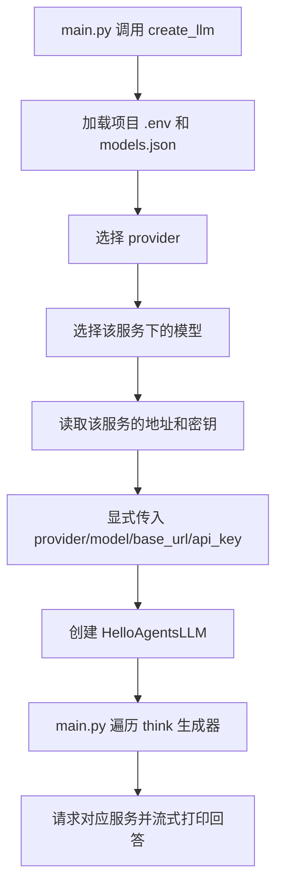

# 模型服务配置与切换说明

本项目借鉴 Pi 的按服务商分组配置方式：先选择服务商和模型，再读取该组地址和密钥，最后显式创建 `HelloAgentsLLM`。这是项目自己的配置格式，不是 Pi 配置文件的完整实现。

## 文件职责

| 文件 | 职责 |
|---|---|
| `models.json` | 服务列表、接口地址、模型列表、默认选择、密钥来源 |
| `.env` | 保存真实密钥；现有凭证保留 |
| `core/llm.py` | `create_llm()` 配置工厂，读取一组配置并创建客户端 |
| `main.py` | 创建客户端、打印实际配置、调用模型 |

安装包源码不作修改。原自定义 `LLM` 子类已被配置工厂替代，项目不再使用该子类。

## 当前默认配置

`models.json` 中 `defaultProvider` 为 `ollama`，默认模型为 `qwen3.5:4b`，地址为 `http://localhost:11434/v1`。

同时保留 ModelScope 连接：模型 `deepseek-ai/DeepSeek-V4.1-Flash`，地址 `https://api-inference.modelscope.cn/v1/`，密钥来自环境变量 `MODELSCOPE_API_KEY`。模型是否仍支持、密钥是否有效，需要实际服务确认，配置检查不会验证这些远端状态。

`.env` 不再保存通用 `LLM_BASE_URL` 和 `LLM_MODEL_ID`；地址和模型归属于各自服务。已有其他密钥保留，但不会参与工厂的服务选择。

## 配置格式

```json
{
  "defaultProvider": "ollama",
  "providers": {
    "ollama": {
      "baseUrl": "http://localhost:11434/v1",
      "apiKey": "ollama",
      "defaultModel": "qwen3.5:4b",
      "models": [{ "id": "qwen3.5:4b" }]
    },
    "modelscope": {
      "baseUrl": "https://api-inference.modelscope.cn/v1/",
      "apiKeyEnv": "MODELSCOPE_API_KEY",
      "defaultModel": "deepseek-ai/DeepSeek-V4.1-Flash",
      "models": [{ "id": "deepseek-ai/DeepSeek-V4.1-Flash" }]
    }
  }
}
```

每个服务约定配置 `apiKey` 或 `apiKeyEnv` 其中一个。`apiKey` 适合本地占位值，真实凭证使用 `apiKeyEnv` 指向环境变量；代码遇到 `apiKeyEnv` 时优先读取它，不额外校验两者是否同时存在。JSON 中不能写 `#` 注释。

本版所有连接均通过 `HelloAgentsLLM` 使用 OpenAI 兼容 Chat Completions 接口，尚不包含协议选择器、交互式模型选择器、OAuth 或自动发现模型。

## 使用与切换

默认连接：

```python
from core.llm import create_llm

llm = create_llm()
```

指定服务：

```python
llm = create_llm(provider="modelscope")
```

指定该服务下的模型：

```python
llm = create_llm(provider="ollama", model="qwen3.5:4b")
```

选择优先级：

```text
provider 参数 → models.json 的 defaultProvider
model 参数 → 所选服务的 defaultModel
```

切换默认服务只需修改 `defaultProvider`，无需注释另一套服务的密钥。`models` 用于记录可选模型，不再校验模型是否登记；显式传入 `model` 可直接覆盖默认值。模型名应与服务实际支持的 ID 一致，本地 Ollama 仍需事先安装该模型并启动服务。

如需其他配置文件：

```python
llm = create_llm(config_path="其他配置.json")
```

默认 `models.json` 和 `.env` 路径由 `core/llm.py` 的位置定位到项目根目录，与终端当前目录无关。显式传入的相对 `config_path` 则相对于当前工作目录；凭证仍从项目根目录 `.env` 加载。

## 执行流程



工厂不会调用基础类的自动服务商检测，因为传入了非空 provider。显式传入模型、地址和密钥，也避免正常配置下通用 `LLM_*` 变量导致跨服务混用。工厂只读取所选服务的配置，未选择的云端服务缺少密钥不影响 Ollama。

`.env` 加载仍采用默认 `override=False`：进程中已有的同名密钥优先。基础类的 `LLM_TIMEOUT` 行为保持原样。

## 运行和排错

```powershell
python -X utf8 main.py
```

UTF-8 模式避免安装包打印表情时出现 GBK 编码错误。当前 main 输出的服务、地址和模型来自同一配置组。

为便于初学者阅读，工厂只保留“读取配置 → 选择服务和模型 → 读取密钥 → 创建客户端”四步。文件不存在、JSON 格式错误、字段或环境变量缺失，直接由 Python 报出对应异常，不统一包装，也不做重复类型校验。仅保留空密钥检查，避免基础类在空值时使用其他服务的凭证。

初始化成功不保证请求成功。服务未启动、认证失败、远端模型不可用或模型能力不兼容，仍由实际请求返回错误。`think()` 仍在遍历时发起请求，并在内部打印片段；外层循环不必重复打印。

## 与旧分析文档的关系

`_docs/HelloAgentsLLM源码与执行流程分析.md` 记录改造前的自动检测调用路径，适合理解基础类源码。其旧 main.py、`.env` 和自定义 LLM 的运行描述属于历史状态；改造后项目入口以本文为准，基础类的流式调用机制不变。
