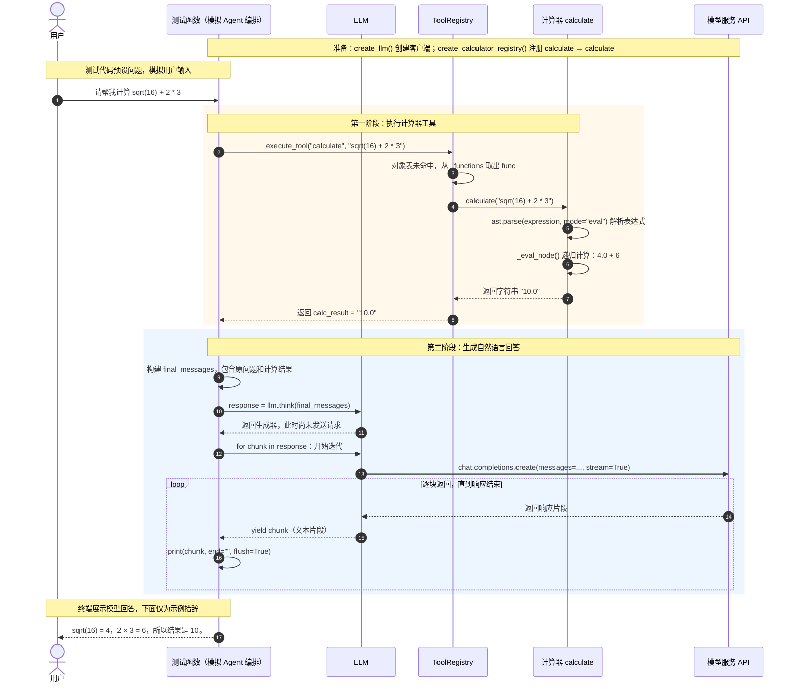

# 计算器工具调用流程

核对日期：2026-10-16。下图对应 `test/test_calculator.py` 中的 `test_calculator_with_llm()`，使用时序图展示调用方向、返回结果及两个处理阶段。

当前测试通过测试函数模拟 Agent 的编排过程，没有创建或调用 `SimpleAgent` 实例。表达式由测试代码指定，模型负责把计算结果组织成自然语言回答。

## 关键角色

| 角色 | 对应代码 | 核心职责 |
|---|---|---|
| 测试函数 | `test/test_calculator.py` 的 `test_calculator_with_llm()` | 指定问题和表达式，调用工具，再把结果交给模型 |
| 工具注册表 | `tools/registry.py` 的 `ToolRegistry` | 按工具名称查找并调用注册的函数 |
| 计算器 | `tools/calculator_tool.py` 的 `calculate()`、`_eval_node()` | 把表达式字符串解析成语法树，再递归求值 |
| LLM 客户端 | `core/llm.py` 的 `create_llm()` 返回的 `LLM` | 连接模型服务，并通过 `think()` 提供流式文本 |
| 模型服务 API | 客户端配置的 `base_url` 和 `model` | 根据问题与工具结果生成回答 |

## 阅读说明

- 实线箭头表示调用或发送数据，虚线箭头表示返回。
- `calculate` 是注册名称，`calculate` 才是实际执行的 Python 函数。
- 工具在本地完成数学计算，不需要请求模型服务；模型在后续阶段生成自然语言回答。
- 使用 OpenAI 兼容接口不代表请求一定发给 OpenAI；实际目标由 `create_llm()` 选择的配置决定。
- `think()` 返回生成器，开始迭代后才执行请求；每个 `chunk` 是一段文本，不保证恰好是一个字或一句话。
- 当前 `think()` 自身也打印文本，测试中的 `print(chunk, ...)` 会再次打印同一片段；图中保留测试代码的调用关系。

用支持 Mermaid 的 Markdown 预览打开本文即可查看时序图。

## 从注册到执行

`create_calculator_registry()` 创建本地注册表，把 `calculate` 名称映射到 `calculate` 函数。注册时的 `func=calculate` 传递函数对象，不会立即计算。

`execute_tool("calculate", expression)` 先检查对象表，未命中后从 `_functions` 取出函数，再执行 `calculate(expression)`。当前同一本地注册表也支持 `CalculatorTool` 对象：注册名为 `calculator`，执行时调用 `run({"input": expression})`，再委托同一个 `calculate()`。同名对象优先，工具异常直接传播。

## 字符串如何变成计算结果

| 阶段 | 输入与作用 |
|---|---|
| 字符串 | `"sqrt(16) + 2 * 3"` 是文本，不能直接作为 Python 算式相加 |
| 解析 | `ast.parse(..., mode="eval")` 解析单个表达式，保留优先级与嵌套关系 |
| 分派 | `_eval_node()` 根据 Constant、BinOp、Call、Name 等节点类型选择处理方式 |
| 递归 | 先算 `sqrt(16)` 与 `2 * 3`，再执行外层加法 |
| 返回 | 数值结果为 `10.0`，`calculate()` 用 `str()` 转为字符串 |

`ast` 是语法树模块，`operator` 提供可放入映射表的运算函数，`math` 提供平方根和常量。`_eval_node()` 是本文件自行定义的辅助函数，不是要从 `ast` 导入的接口。

`mode="eval"` 是解析模式，不是调用内置 `eval()`。当前计算器没有使用内置 `eval()` 执行传入文本，但仍需按实际节点处理能力判断支持范围。

## 当前支持范围与边界

- 基础数字加减乘除、括号、`sqrt()`、`pi` 已有处理路径。
- 运算表虽然包含正负号，但 `_eval_node()` 没有 UnaryOp 分支，所以 `-5`、`+3` 当前不按预期求值。
- 未识别节点或名称可能隐式返回 `None`；不支持的二元运算符可能触发 TypeError，转为计算失败文本。
- Constant 当前未限定数字类型，函数调用分支也只适配普通函数名，不能把它描述成完整的数学语言或通用安全执行器。
- `calculate()` 捕获 SyntaxError、ValueError、ArithmeticError、TypeError；例如属性形式调用引发的 AttributeError 不在此范围。
- `test_calculator_with_llm()` 会访问真实模型；前面的基础计算用例只在本地计算。二者主要打印结果，没有为每个结果设置自动断言。

## 与工具链和并发调用的关联

计算器在本地注册表中的名称是 `calculate`。工具链与异步执行器都采用 `execute_tool(name, input)` 调度，调用前必须在同一个注册表中登记该名称；创建另一个工具工厂返回的新注册表，不会自动合并原有工具。

研究工具链当前把“根据以下信息计算相关数值:”和搜索结果一起传给计算器，这不是合法数学表达式，需要先完成信息提取。并发示例虽然列出计算任务，但尚未注册计算器，不能据示例存在认为已跑通。

详见 [工具链与异步执行说明](工具链与异步执行说明.md)。相关分支图见 [核心代码流程](flows/核心代码流程.md)。返回 [文档导航](文档导航.md)。
