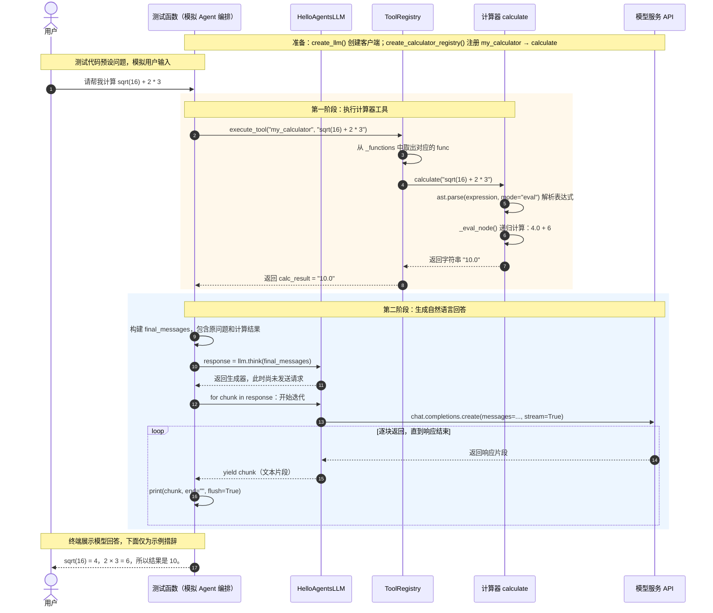

# 计算器工具调用流程

下图对应 `test/test_calculator.py` 中的 `test_with_simple_agent()`，参考示例使用时序图展示调用方向、返回结果及两个处理阶段。

当前测试通过测试函数模拟 Agent 的编排过程，没有创建或调用 `SimpleAgent` 实例。表达式由测试代码指定，模型负责把计算结果组织成自然语言回答。

## 关键角色

| 角色 | 对应代码 | 核心职责 |
|---|---|---|
| 测试函数 | `test/test_calculator.py` 的 `test_with_simple_agent()` | 指定问题和表达式，调用工具，再把结果交给模型 |
| 工具注册表 | `tools/registry.py` 的 `ToolRegistry` | 按工具名称查找并调用注册的函数 |
| 计算器 | `tools/calculator_tool.py` 的 `calculate()`、`_eval_node()` | 把表达式字符串解析成语法树，再递归求值 |
| LLM 客户端 | `core/llm.py` 的 `create_llm()` 返回的 `HelloAgentsLLM` | 连接模型服务，并通过 `think()` 提供流式文本 |
| 模型服务 API | 客户端配置的 `base_url` 和 `model` | 根据问题与工具结果生成回答 |

## 阅读说明

- 实线箭头表示调用或发送数据，虚线箭头表示返回。
- `my_calculator` 是注册名称，`calculate` 才是实际执行的 Python 函数。
- 工具在本地完成数学计算，不需要请求模型服务；模型在后续阶段生成自然语言回答。
- 使用 OpenAI 兼容接口不代表请求一定发给 OpenAI；实际目标由 `create_llm()` 选择的配置决定。
- `think()` 返回生成器，开始迭代后才执行请求；每个 `chunk` 是一段文本，不保证恰好是一个字或一句话。
- 当前 `think()` 自身也打印文本，测试中的 `print(chunk, ...)` 会再次打印同一片段；图中保留测试代码的调用关系。

用支持 Mermaid 的 Markdown 预览打开本文即可查看时序图。
